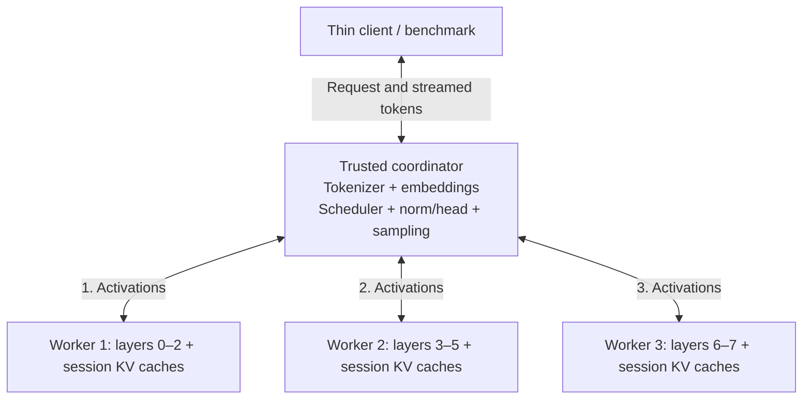

# Replicant Mesh

Cooperative LLM inference across consumer devices: a research prototype for
testing whether pooled memory and otherwise idle compute can provide useful
access to larger models or additional inference capacity.

**Status:** public experimental source preview; local CPU research lab.
**License:** [Apache-2.0](LICENSE) for this project's code and documentation;
third-party software and model artifacts retain their own terms.

Existing checkouts and lab deployments should follow the
[rename and migration guide](docs/RENAMING.md) before upgrading.
The canonical GitHub repository is `mat092011/replicant-mesh`.

The primary question is whether sharing resources is useful after communication,
scheduling and verification costs. Faster generation for one user is a separate
hypothesis. Reciprocal credits are a later research phase; no credit system exists.

## What works today

- An owned PyTorch runtime partitions a real, eight-layer transformer across
  three supervised worker containers, with resident weights and per-session KV
  caches. Petals is an optional historical baseline in a separate environment.
- A trusted coordinator handles model input/output, bounded FIFO scheduling,
  streaming, admission, deadlines and cancellation. Independent requests can
  overlap across workers.
- Numerical checks compare identical inputs and forced continuations against a
  complete-model reference. Lifecycle checks cover session isolation, cleanup,
  limits and worker faults.
- A private Docker lab measures network sensitivity, client-observed latency,
  completed-output throughput and resource observations, retains failed runs,
  and verifies network reset.

Runtime milestones **M0–M5 are implemented**, but the broader research gates
**P0–P3 remain incomplete**. Research measurements use CPU containers on one
laptop; hosted CI checks the same colocated CPU topology on a GitHub runner.
Separate-device stages, GPU execution, useful pooled-memory inference,
automatic replay recovery and public internet deployment remain unverified or
unimplemented. See the [development roadmap](docs/ROADMAP.md) and
[research acceptance criteria](docs/PLAN.md).

## How inference works



The coordinator sends each request through workers **1 → 2 → 3**, relaying every
activation exchange. Workers do not forward activations directly to each other.
The coordinator selects the next token and feeds it back through the embedding
before that request's next decode step. Different requests can occupy different
workers at the same time; successive tokens from one answer remain dependent.

The tiny checkpoint places about **89% of its parameters in the coordinator's
input/output components**. It tests mechanics, not the memory distribution of a
large production model. See the [component budget](docs/PYTORCH_RUNTIME.md).

## What the experiments show

The [16 October 2026 P3 report](docs/experiments/2026-10-16-pytorch-p3-continuation.md)
records two separate experiment sets:

| Experiment | Completed requests | Observation |
| --- | --- | --- |
| LAN vs 10 ms added egress delay | 612/612 total | Pipeline output throughput was 156.98–158.28 tokens/s on LAN and 37.27–37.30 with delay |
| Fresh LAN pipeline vs complete-model replicas | 306/306 per topology | Pipeline delivered 157.22–158.66 output tokens/s; replicas delivered 710.54–717.98 |

Each configuration has three repetitions at 128 prompt tokens, 64 output tokens,
and three active sessions. Ranges are across repetitions, not pooled statistics.
The delay subset and fresh matched comparison use different recorded images;
their results are not pooled. The report also includes first-token/inter-token
latency, retained control setup failures, measured network conditions and resets.

The replica comparison matches configured aggregate CPU/RAM ceilings and uses
the same corrected runtime image. Replicas were faster for this locally fitting
tiny model. This establishes no pipeline efficiency or pooled-GPU benefit.
All services share the same laptop and Docker VM; simulated links do not establish
performance on separate devices or real internet connections. Energy and thermal
behavior were not measured.

## Run the private lab

### Requirements

- Docker with Compose and a Linux amd64 engine; the verified host is Windows
  with Docker Desktop's Linux backend. Other host setups need reproduction.
- Internet access for image building and pinned model preparation. Subsequent
  inference uses verified, read-only offline artifacts.
- Enough available RAM for the selected services. Sequential validation
  containers have a 6 GiB limit each; the four inference services have 3 GiB
  limits each, plus the thin client and any validation process. These are
  configured ceilings, not measured minimum requirements; budget the full setup
  using the [lab guide](docs/PYTORCH_LAB.md).
- PowerShell for the supplied experiment/network-shaping scripts. Host Python
  is not needed for the container quick start.

The owned runtime supports only `Maykeye/TinyLLama-v0` and its tokenizer at
revision `298338802ab94432b917bcce11382aa151aee50f`: CPU float32, eager attention,
batch size one per session, and fixed layer assignments. The
[runtime environment](docker/pytorch/README.md) records the dependency lock.
The root `.env.example` configures the legacy Petals lab; editing it does not
change the owned PyTorch manifest.

Clone the public source if you do not already have a checkout:

```powershell
git clone https://github.com/mat092011/replicant-mesh.git
cd replicant-mesh
```

Run these commands sequentially from the repository root in PowerShell:

```powershell
docker.exe compose -f compose.pytorch.yaml build prepare
docker.exe compose -f compose.pytorch.yaml run --rm prepare
docker.exe compose -f compose.pytorch.yaml run --rm tests
docker.exe compose -f compose.pytorch.yaml up -d --wait worker-1 worker-2 worker-3 coordinator pipeline-benchmark
docker.exe compose -f compose.pytorch.yaml run --rm --no-deps service-check
```

Continue only after each command succeeds. The test service supplies the artifact
paths and integration flags required for the complete checks; a host test run
that skips model-dependent tests is not equivalent. Build and validation evidence
is linked from the [M5 report](docs/experiments/2026-10-16-pytorch-m5.md) and
[P3 follow-up](docs/experiments/2026-10-16-pytorch-p3-continuation.md). The
[release validation record](docs/experiments/2026-10-17-release-readiness.md)
records a fresh local-clone reproduction with isolated artifact volumes. This is
same-laptop reproduction, not independent-device evidence.

After the numerical/lifecycle gate passes, run a short benchmark:

```powershell
docker.exe compose -f compose.pytorch.yaml exec -T pipeline-benchmark python -m lab.benchmark bench --backend pipeline --coordinator coordinator:50052 --prompt-tokens 128 --new-tokens 8 --concurrency 3 --requests 6 --label first-local-smoke
```

This is a smoke check, not a performance study. Reports go to ignored
`.lab/pytorch-results/`; warm-up/loading are excluded and prompt tokens are not
counted as generated output. Follow the [lab guide](docs/PYTORCH_LAB.md) for
complete-model controls, frozen repeated experiments, shaping and verified reset.
Stop the lab when finished:

```powershell
docker.exe compose -f compose.pytorch.yaml down
```

This keeps prepared model volumes. Network-shaping experiments must perform and
verify their documented reset before shutdown; stopping containers alone is not
a recorded reset check.

## Trust and deployment limits

This is a trusted private lab. RPC has **no authentication or encryption**;
the private-network flag is not an access-control mechanism. Compose publishes
no host ports. Do not expose these listeners publicly or connect untrusted peers.
Only the services used for packet shaping receive `NET_ADMIN`.

Use public or synthetic prompts. Worker owners can inspect computations;
activations are not a privacy guarantee. A worker restart invalidates affected
sessions, and ambiguous steps are not automatically retried. Authentication,
secure transport, replay recovery and abuse-resistant credits need separate gates.

## Contribute and develop

Start with [CONTRIBUTING.md](CONTRIBUTING.md). Useful early contributions include
independent reproduction, clearer evidence, experiment coverage and bounded
failure cases. Changes to the runtime, model, scheduler or topology need explicit
configuration provenance and renewed correctness checks.

- [Development roadmap](docs/ROADMAP.md): prioritized work and completion criteria.
- [Research plan](docs/PLAN.md): P0–P8 hypotheses and experimental gates.
- [Release readiness](docs/OPEN_SOURCE_RELEASE.md): reviewed gaps and remaining release blockers.
- [Third-party review](docs/THIRD_PARTY.md): dependency/model terms and outstanding provenance work.
- [Security policy](SECURITY.md): deployment limits and the GitHub private reporting plan.

## Technical guides

| Topic | Guide |
| --- | --- |
| Owned runtime and same-stack reference | [Runtime](docs/PYTORCH_RUNTIME.md) |
| Binary messages, validation and leases | [Protocol](docs/PYTORCH_PROTOCOL.md) |
| Fixed workers and process supervision | [Workers](docs/PYTORCH_WORKERS.md) |
| Admission, streaming and request overlap | [Coordinator](docs/PYTORCH_COORDINATOR.md) |
| Standalone service, controls and network experiments | [Lab](docs/PYTORCH_LAB.md) |
| Coverage audit and immutable continuation | [Experiment analysis](docs/PYTORCH_EXPERIMENT_ANALYSIS.md) |
| Local inventory and arithmetic memory budgets | [Capacity preparation](docs/PYTORCH_CAPACITY.md) |
| Implemented M0–M5 scope and gates | [Runtime implementation plan](docs/PYTORCH_PIPELINE_PLAN.md) |
| Optional older-stack Petals baseline | [Historical lab](docs/LOCAL_LAB.md) |

## License

This project's code and documentation are licensed under
[Apache License 2.0](LICENSE), except where third-party terms apply. It permits
commercial use and proprietary derivatives subject to its conditions, including
license/notice preservation and notices of modifications. It includes a limited
contributor patent grant and does not grant trademark rights.

Dependencies, model weights, tokenizers and datasets are not relicensed by this
repository. Weights and prepared shards are downloaded locally rather than
committed or included in the runtime image. See the [third-party review](docs/THIRD_PARTY.md)
before redistributing artifacts or images. The source repository is public;
no package, container image, model bundle or versioned release tag is published
as part of this preview. See the [publication record](docs/experiments/2026-10-17-publication.md).
