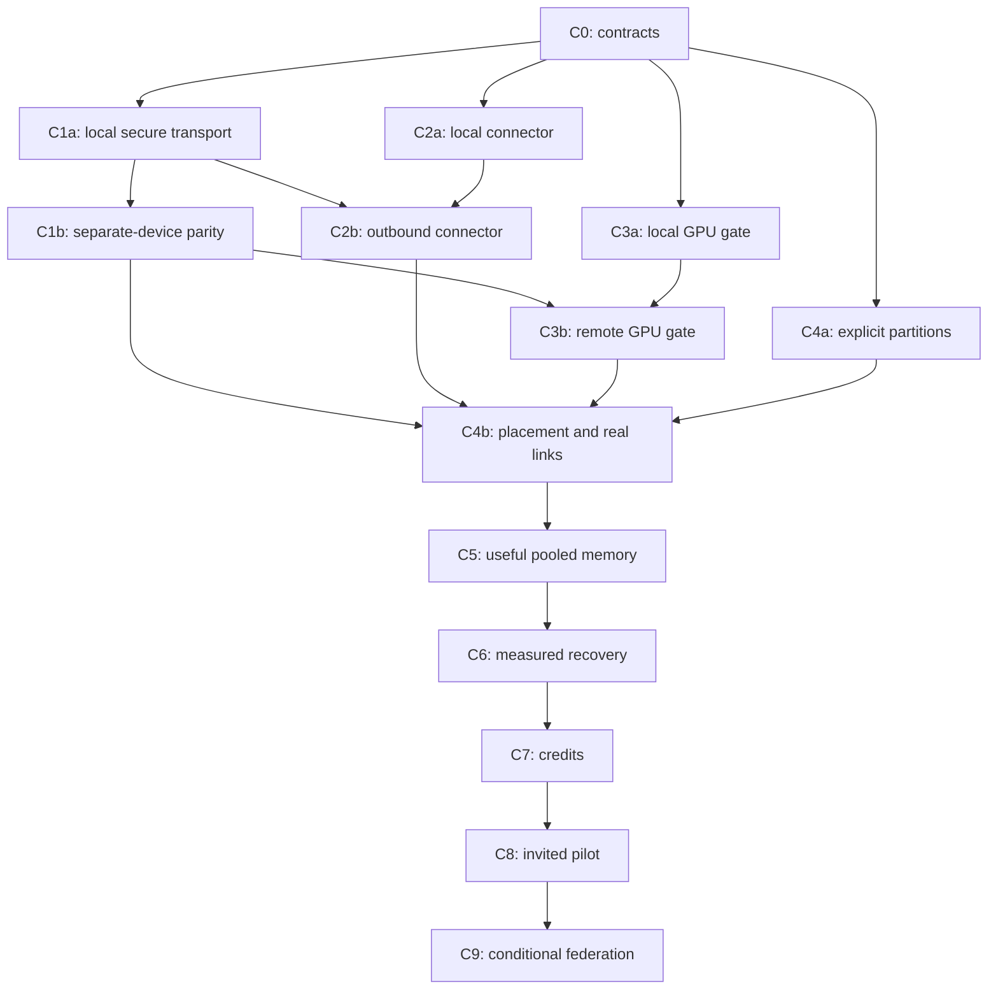

# Multiphase execution plan: participant network

Prepared 2026-10-17 from [PARTICIPANT_NETWORK_PLAN.md](PARTICIPANT_NETWORK_PLAN.md).
**C0 passed on 2026-10-17; C1 validation and exit criteria were accepted on
2026-10-19; C2 implementation is in progress and unaccepted; C3–C9 remain
planned.** See the [C1 final validation
record](experiments/2026-10-18-participant-c1.md) and [C0 validation
record](experiments/2026-10-17-participant-c0.md). Trial 78 passed all 878
unique required software-regression cases with zero skips, failures or errors
in 367.862 seconds on the laptop. Physical RST7, Drain4 and Remove4 passed
bounded checks; Trial 75 M1/M2 controls and focused 359-case validation
also passed. Trial 76, Native ZimaBlade run 3, Trial 77 and full-history DIAG3
failures remain recorded with unknown causes; Trial 78 does not explain them,
and no hardware cause is established. Separate-device evidence retains its own
frozen source and image identities. The AMD 890M GPU backend remains
unvalidated. The original stop-after-C1 instruction was historical; C2 resumed
on 2026-10-19 and remains in progress and unaccepted.

This document owns the C0–C9 execution sequence, task checklists and engineering
exit criteria. The [architecture plan](PARTICIPANT_NETWORK_PLAN.md) explains the
design; [PLAN.md](PLAN.md) owns research acceptance and evidence for P0–P8.
[PYTORCH_PIPELINE_PLAN.md](PYTORCH_PIPELINE_PLAN.md) records the implemented M0–M5
runtime. These identifiers are separate: completing a connector phase does not
automatically complete a research phase.

The intended progression is a secure fixed cohort, an installable connector,
measured GPU pipelines, useful pooled memory, recovery, credits and an invited
pilot, followed by conditional federation. Participants can consume inference,
host contiguous model components, or operate an authorized coordinator. Global
membership supplies many suitable routes and replicas; each request uses a
bounded subset of compatible machines.

## Phase overview

C0 is **Passed**; C1 is **Passed**; C2 is **In progress**; C3–C9 are **Planned**. The hardware column describes an exit requirement,
not a reason to stop independent preparation. Responsibility labels are proposed
roles, not assigned people or staffing commitments.

| Phase | Outcome | Completion dependencies | Hardware / external requirement | Lead responsibility | Supports research |
| --- | --- | --- | --- | --- | --- |
| C0 | Agreed contracts and experiment boundaries | Existing baseline reviewed | Hardware access may remain an explicit open dependency | Maintainer / architecture | P0 |
| C1 | Secure fixed cohort with real-device parity | C0; C1a and C1b below | At least two physical devices and an authenticated route | Network / security | P0–P2 |
| C2 | Headless consumer/host/personal-orchestrator connector | C0, C1a; real-route validation | Test participant machine and outbound gateway/route | Connector / platform | P0–P2, groundwork for P5 |
| C3 | One verified GPU backend | C0; C1 for remote gate | Actual supported GPU and remote test access | Runtime / GPU | P1–P3 |
| C4 | Flexible placement and measured real-link envelope | C1–C3; supported topology gates | Separate LAN and internet sites; measured route types | Runtime / research | P2–P3 |
| C5 | Measured useful pooled-memory configuration | C3, C4 | Suitable accelerator cohort, model and local controls | Research / runtime | P4 |
| C6 | Bounded recovery and availability scheduling | C4; C5 continue decision for expansion | Replacement capacity and fault-injection access | Runtime / reliability | P5 |
| C7 | Auditable credits and operator controls | C5, C6 | Trusted ledger/verification operator and resource budget | Accounting / security | P6 |
| C8 | Supported desktop distribution and invited pilot | C2; C5–C7 for pilot | Recruited participants and support ownership | Connector / operations | P7 |
| C9 | Evaluated federation and open-network options | C8 continue decision and adversarial review | Multiple actual trust domains/operators | Architecture / security | P8 |

## Dependencies and parallel work

Use local sub-gates to avoid coupling all engineering work to hardware arrival:

- **C1a** is authenticated transport/admission implementation and local tests;
  **C1b** is its evidence on physically separate devices. Both complete C1.
- **C2a** is local daemon/consumer/lifecycle work after C0; **C2b** adds enrollment
  and outbound serving after C1a. C2 completes only with the real-route checks.
- **C3a** is a local GPU reference and worker gate on confirmed hardware after C0;
  **C3b** is remote numerical/lifecycle validation after C1. Both complete C3.
- **C4a** is explicit manifest/stage generalization, initially testable on CPU;
  **C4b** is measured placement and real-network evaluation after C1–C3.

The graph shows the principal completion path. C6 protocol/fault-fixture work
may begin after C4, while its expansion gate waits for the C5 decision. C8 UI work
may begin after C2, while the pilot waits for C5–C7. Recruitment, selected existing
CPU experiments and reproducibility work can proceed alongside these tracks.
Direct peer links are an optional measured C4 extension; they are not required
to develop the secure gateway path.

## C0 — Freeze contracts and acceptance boundaries

**Outcome:** implementers know which roles, operations, platforms and evidence the
first connector supports. **Entry:** review the current CPU baseline and the
architecture plan; do not treat existing design prose as an approved contract.

**Tasks**

- [x] **C0.1** Record an architecture decision for consumer, host and orchestrator
  permissions; trusted registry/coordinator/catalog boundaries; and personal
  versus community operator mode. Keep public enrollment and credits out of the
  first runtime slice.
- [x] **C0.2** Specify account, device, boot, request, session, route and operation
  identities; model/runtime/placement compatibility; credential rotation and
  revocation; and a versioned control/inference protocol boundary.
- [x] **C0.3** Specify resource policy and shared local reservations for memory,
  disk, bandwidth, queues, concurrency and deadlines. Define drain, immediate
  stop, removal, unavailable telemetry and unsupported-platform behavior.
- [x] **C0.4** Choose the initial supported platform and secure route approach.
  Record hardware recruitment, gateway ownership and operating budgets as open
  dependencies where unconfirmed; assign responsibility before remote trials.
- [x] **C0.5** Prepare the first fixed-cohort experiment manifest, numerical
  criteria, fault cases and evidence schema. Define fields for later hardware
  values; freeze those values before their associated experiment starts.

**Deliverables:** versioned schemas/configuration examples, architecture decision,
threat model, test matrix and an explicit dependency register. New runnable
commands must be documented only when implemented.

**Exit gate:** review confirms unambiguous permissions, limits and failure
semantics; no unresolved choice prevents local C1a/C2a work. Unconfirmed hardware
and later usability targets remain named dependencies, not assumed facts. The
existing CPU/Petals paths remain the controls.

**Evidence / next:** the [reviewed decision](decisions/0001-participant-contracts.md),
[normative contract and dependency register](PARTICIPANT_CONTRACTS.md),
[versioned declarations](../config/participant/README.md) and
[Docker validation record](experiments/2026-10-17-participant-c0.md) complete C0.
Start isolated C1a and C2a, and CPU C4a preparation. C3a execution awaits supported
GPU access. No security implementation, physical-route, GPU or research gate is
completed by C0; external operator/hardware dependencies remain open.

## C1 — Secure a fixed invited cohort

**Outcome:** the existing fixed pipeline can run across authenticated participants.
**Entry:** C0; at least two real devices are required for C1b, not for C1a.

**Tasks**

- [x] **C1.1 / C1a** Add an explicit TLS peer-authenticated transport profile to
  worker and coordinator services/clients. Preserve isolated insecure-lab
  configuration; never make the private-network flag authorize internet access.
- [x] **C1.2 / C1a** Implement invited enrollment, protected device credentials,
  scoped coordinator permissions, expiry/revocation and identity-bound sessions.
  Session IDs alone must not grant access.
- [x] **C1.3 / C1a** Bound connections, handshakes, admission and malformed payloads.
  Test wrong roots/identities/roles, expired or revoked credentials, stolen session
  IDs, reconnect and loss after possible cache mutation. Retain no automatic
  ambiguous-step retries.
- [x] **C1.4 / C1b** Inventory two or more physical devices and their actual route.
  Freeze model/runtime, public fixtures, resource ceilings and test bounds. The
  fixed three stages may share devices; record exactly where they execute.
- [x] **C1.5 / C1b** Run same-input prefill/forced-decode comparisons, interleaved
  sessions, cancellation, partial admission, restart/boot-ID invalidation and
  bounded cleanup across those devices.

**Deliverables:** secure configuration, enrollment/revocation procedure, local
negative tests and a sanitized separate-device correctness/lifecycle report.

**Exit gate:** C1a rejects every invalid admission case within declared resource
bounds and preserves valid session semantics. C1b passes the frozen numerical and
lifecycle checks on actual separate machines. If hardware is missing, record C1a
independently and leave C1b pending; containers cannot substitute for this gate.

**Evidence / next:** the [C1 final validation record](experiments/2026-10-18-participant-c1.md) records the accepted software regression and bounded physical evidence. C1 is complete; work stops here as requested. C2–C9 remain planned. The AMD 890M backend remains unvalidated.

## C2 — Deliver the headless participant connector

**Outcome:** a participant can consume inference, contribute a supported shard,
and explicitly enable personal orchestration using one controlled application.
**Entry:** C0 for C2a, C1a for secure integration; real routing for final acceptance.

**Tasks**

- [ ] **C2.1 / C2a** Add a CLI/daemon and authenticated local management interface.
  Reuse worker/coordinator supervision. Keep the consumer SDK free of PyTorch and
  model downloads; enable each execution role separately.
- [ ] **C2.2 / C2a** Implement diagnostics, policy, status, start, drain, immediate
  stop and removal. Reserve shared resources across all local roles; report
  unsupported limits and insufficient capacity instead of silently overcommitting.
- [ ] **C2.3 / C2a** Install only approved assigned artifacts; verify identities
  before loading offline. Test corrupt/interrupted downloads, disk exhaustion,
  incompatible versions, hung compute and bounded log/cache growth.
- [ ] **C2.4 / C2b** Connect enrollment, expiring readiness, heartbeat and one
  bounded outbound work stream or tunnel. Define multiplexing, backpressure,
  cancellation and reconnect behavior; registration alone is not a work channel.
- [ ] **C2.5 / C2b** Add consumer submission/stream/cancel and personal coordinator
  startup, with input/output component budgets, worker permission and complete
  route checks. Preserve explicit failure after ambiguous mutation.
- [ ] **C2.6 / C2b** Exercise enrollment through first completed inference on a
  separate supported participant machine, including an outbound-only tested
  route without manual router-port changes. Capture install and stop behavior.

**Deliverables:** proposed `src/steamboat_connector/`, focused connector tests,
supported-platform guide and reproducible install/start/leave procedure. Source
installation can support the first trial; verify binary distribution before
shipping installers in C8.

**Exit gate:** consumer-only mode needs no model runtime; authorized roles work
together without double reservations. Readiness requires checked loaded weights,
healthy compute and available resources. Owner stop controls remain responsive
under hung inference; the real-route lifecycle and numerical checks pass. Secrets
and prompts do not appear in default logs.

**Evidence / next:** record tested OS/runtime/route and unsupported platforms.
Begin C4 integration and optional C8 UI scaffolding; no community pilot yet.

**Implementation resumed, 2026-10-19:** the maintainer authorized continuing C2
after completed C1 publication. The [component record](experiments/2026-10-19-participant-c2-components.md)
records component 27's latest complete 562-case, skip-free Docker inventory,
superseding the historical 474-case component 26. Selected native-9 passed 42
cases (RPC 8, protobuf guard 8, SDK 12, egress 14); independent source reviews
accepted the bounded RPC/SDK changes, and component 27 includes bounded passing
native signed-C1 `WorkerHandler` evidence. Capture-native1 passed parser controls
with valid-data and control native RSS high-water deltas still unmeasured. The
selected-cohort validator source review passed and inherited-main native-2
passed 12 tests, but the validator remains inert without local identities,
claims or startup. The earlier
pinned-artifact child handoff and watchdog-publication fixture also passed their
bounded probes. Full deployed RPC/SDK/transport integration, whole-cohort claims,
gateway integration and aggregate root-group startup remain incomplete or under
review. A separate ZimaBlade OS probe verified task-scoped CPU/RAM enforcement.
Actual fixed-role backend, enrollment, dual-listener gateway, shared resource
integration and the outbound split-host route remain incomplete; every C2
checkbox remains open and C3 has not advanced.
The [connector design](PARTICIPANT_CONNECTOR_DESIGN.md) freezes the required gates.

**Latest evidence, 2026-10-19:** component 29's bounded connector plus 21
selected security modules suite passed 705 tests with no skips/failures/errors
(38.605 s; 432-file snapshot,
head `1b221ff`). The follow-on native probes passed local claim (12), global
claim (15), coordinator (9), route (14), and startup seam (58) tests; the
root-runtime final-lock causal test passed after its old-version control failed.
These results remain private component evidence, not C2 acceptance. Claims are
inert, binding is not readiness, routing has not integrated shared physical
resources, and the seam uses fake cgroup limits. Its first 57-pass run had a
reviewed final-poll handle-consumption issue; the subsequent 58-pass run tests
the correction. Main review also found a separate coordinator/host deadline
retention defect not covered by the latest native probe; its fix remains
unintegrated. Component 29 predates the claim-lifetime and seam integration
commits, so no combined rebuild has validated that integrated head. The record
retains earlier component-28 fixture failures and invalid/failed native
harness attempts.
Every C2 checkbox remains open; C3 has not advanced. Local startup, actual
enrollment/roles/gateway, shared CPU/RAM/disk/traffic enforcement and the CT-11/
CT-13 laptop-to-ZimaBlade routed lifecycle gate remain outstanding.

**Component 30, 2026-10-19:** the bounded connector plus 24 selected security
modules inventory passed 770 unique tests with zero skips/failures/errors in
45.992 seconds. It used frozen source head `5a007e8` (445 files; digest
`2d2083006e25afbb5c7569781f394835baf528ac9ca8dae7619a767db05caa18`) and
pinned image `sha256:42ee4553918ba7b636d3a374d84f96094f1daed30cf97b4be50798cf3b5f6798`;
all baked source matched and the container exited 0 without OOM. This is not the
full repository or full C1 regression. Focused deadline controls passed on a
later 437-file native source overlay, but the 770-case combined inventory was
not rerun after two subsequent test-only instrumentation assertions. A separate
owner-consent implementation passed a focused 14-test native probe after
source review and was later privately integrated. This remains outside the
combined inventory and does not establish controller startup, role launch or
READY; its earlier 10-test probe had one fixture failure and one fixture error.
See the
[component evidence record](experiments/2026-10-19-participant-c2-components.md)
for hashes, retained failures and exact scope. Every C2 task and its phase exit
gate remain open; C3 has not advanced.

**Component update, 2026-10-19:** component 31 passed 797 unique cases with no
skips, failures or errors; component 32 is the latest integrated bounded suite
with 872 unique passes and no skips, failures or errors. It covers all
connector tests, 25 selected security modules and two selected runtime modules,
not the full repository or C1 regression. The component report records the
frozen source/image identities, resource limits, focused native evidence and
retained failures. These results do not establish fixed-role readiness, a
deployed multi-device route, shared physical resource enforcement or CT-11/CT-13
acceptance. C2.1–C2.6 and the C2 exit gate remain open; C3–C9 remain at their
existing statuses. Selected-pin catalog and assignment-hash checks were
pending at the combined-inventory checkpoint and were separately exercised in
a later artifact-scope native run. Later focused evidence also covers the
cohort client, runtime guard/RPC cleanup and component-32 checks on ZimaBlade;
the report retains earlier fixture failures and scopes. These checks do not
close a C2 task or phase gate.

**Component 33 update, 2026-10-19:** the focused host-assembly run passed 8
tests, zero skips, in 6.001 seconds against source head
`1ca5f3f42e3cf130e4a41287134d29e315f315f1` (digest
`9822bd408011bf18ebdfdbb6c82961d69760011e4176a0874fd10d7e5782a3c1`). It
covered signed C2 host binding, inherited pins, an offline assigned stage and
a real C1 Describe over the guarded bridge. Forced-hidden-state comparisons
were made through the direct handler against its assigned local stage
reference (`atol=1e-6`, `rtol=0`), not through RPC. Component 33's combined
911-test run had 910 passes and one failure, with no skips, on a 471-file
snapshot; the failure came from an outdated AST test probe, not a passing
combined result. The corrected probe later passed 12 focused tests. The
bounded run covers connectors, 27
selected security modules and two runtime modules; it is not full C1 or the
whole repository. Host assembly evidence does not establish fixed-role
readiness, shared physical resource enforcement or deployed multi-device
routing. C2.1–C2.6 and the C2 exit gate remain open, and C3 has not advanced.
Hashes, retained attempts and limits are in the
[component record](experiments/2026-10-19-participant-c2-components.md).

A later focused consumer runtime-guard run passed 48 tests with zero skips in
16.285 seconds on a 470-file snapshot (head
`2a24b99d51a7d79e7eae2f24d748b72ffa739db1`, digest
`8af0cb35015177e2360aec0857865d9eff679cde27afbdeda8f02a0aa090051f`). The
run combines existing consumer transport tests, fake-client guard/delivery/
cancellation tests and actual signed C2 consumer-binding tests. It does not
wire the binding owner into live C1 RPC or controller delivery. The combined
component-33 result remains at 910 passes and one test-probe failure in the
historical record. Component 34 subsequently reran that bounded inventory with
the corrected probe and consumer tests: 925 unique passes, zero skips/failures/
errors, on a 473-file frozen snapshot. A separate focused persistent channel-
policy-owner run passed 11 tests, but it was not included in component 34 and
does not implement transport ownership. These remain focused component results,
not C2 phase acceptance; C2.1–C2.6 remain open.

Focused Clock-bridge, host settings/binding and coordinator settings native
checks subsequently passed 25, 33 and eight tests respectively, all with zero
skips, failures or errors. These source-reviewed library results are separate
from component 34; actual role/process/consumer integration and the real C2
route remain pending. See the component record for retained failures and pins.
C2.1–C2.6 and the phase exit gate remain open.

## C3 — Validate one GPU execution path

**Outcome:** one explicitly supported GPU/backend/precision combination preserves
the model and session contract. **Entry:** C0 and actual supported GPU access for
C3a; complete C1 for C3b. Do not infer GPU support from inventory alone.

**Tasks**

- [ ] **C3.1 / C3a** Select the cohort/backend and isolate its image/dependency
  lock from CPU and Petals. Pin drivers/runtime compatibility, precision and
  attention implementation; keep architecture/model support narrow.
- [ ] **C3.2 / C3a** Make weight, activation and per-layer KV placement explicit.
  Budget loading peaks, temporary buffers, allocator use and local shared roles.
- [ ] **C3.3 / C3a** Build the complete-model reference on the same GPU stack.
  Establish numerical tolerance from repeated controls before the partition gate;
  test full prefill/forced decode, boundaries, interleaving and cancellation.
- [ ] **C3.4 / C3a** Measure loading/execution peak memory and synchronized GPU
  compute durations. Test changing free memory, OOM rejection and supervisor
  recovery without attributing enqueue time to completed computation.
- [ ] **C3.5 / C3b** Repeat parity/lifecycle checks over the secure physical route
  for the supported configuration. Record device layout and CPU/GPU transfers.

**Deliverables:** isolated GPU environment, supported device/precision contract,
same-stack reference and local/remote numerical and resource reports.

**Exit gate:** finite logits meet the frozen justified tolerance, cache/session
isolation and cleanup pass, and actual memory/timing observations are available.
C3b requires real remote evidence. No speedup or support for other vendors follows
from this gate; multiple processes on one GPU remain one physical resource pool.

**Evidence / next:** attach hardware/backend-specific evidence and proceed to C4.
If no GPU is available, prepare interfaces and fixtures without marking C3 passed.

## C4 — Generalize placement and measure real links

**Outcome:** the system selects complete supported routes from measured capacity
and has a repeatable performance envelope. **Entry:** C0 for CPU C4a design/tests;
complete C1–C3 for C4b integration and GPU real-link evaluation.

**Tasks**

- [ ] **C4.1 / C4a** Separate model/artifact, runtime-compatibility and placement
  identities. Remove fixed three-worker assumptions behind explicit supported
  manifests; validate 1/2/3-stage cases, exact layer coverage and component owners.
  Propagate supported shape, dtype, vocabulary and context contracts into clients
  and wire validation. Replace tiny-model constants only through versioned limits;
  define bounded messages or validated streaming/chunking before larger payloads.
- [ ] **C4.2 / C4a** Preserve an in-process/full-model reference for every supported
  partition. Keep embeddings/head and tied-weight accounting explicit; retain
  the current coordinator placement as a comparison when moving components.
- [ ] **C4.3 / C4b** Add expiring candidate registrations, bounded probes of actual
  route endpoints, measured stage/cache budgets and warm-stage preference. Reserve
  every stage before execution; enforce shared quotas across coordinators.
- [ ] **C4.4 / C4b** Freeze per-tenant queues, active limits and the bounded owner
  share. Test mixed prompt lengths and competing coordinators under saturation.
  Preserve the known non-preemptible-prefill limitation unless chunking passes
  its own numerical/lifecycle gate.
- [ ] **C4.5 / C4b** Execute selected same-host, separate-LAN and real-internet
  comparisons with matching workload/resources. Record direct/relayed reachability,
  route bytes, token feedback, RTT/goodput, failures and actual infrastructure cost.
  Record useful compute overlap separately from overlapping RPCs, with bounded
  cross-host clock uncertainty whenever comparing absolute worker spans.
- [ ] **C4.6 / C4b** Compare supported direct and relayed routes; introduce direct
  worker forwarding only if justified and validated as a distinct topology.
  If a route type cannot be tested, retain that coverage gap and narrow claims.

**Deliverables:** generalized contracts/scheduler, real-route measurement support,
frozen experiment manifests and a report showing latency/capacity tradeoffs.

**Exit gate:** supported partitions and maximum accepted prefill/logit payloads
pass parity; oversized or incompatible messages are rejected before tensor allocation.
Stale/incompatible advertisements are rejected, and concurrent admission cannot
exceed declared shared reservations. Unexpected memory pressure, inaccurate
capacity claims and OOM cause bounded rejection or failure. The preregistered
LAN/internet cases retain successes, failures, fair-service results and resource
measurements. Optional direct forwarding is not required to declare a tested
relayed envelope; incomplete topology coverage remains explicit.

**Evidence / next:** publish continue/revise/stop guidance for the selected model
and routes. A bounded C4 study does not silently close all outstanding P3 coverage.
Select a C5 cohort/model only from the measured feasible region.

## C5 — Demonstrate useful pooled memory

**Outcome:** multiple participant machines enable useful inference for a fixed
configuration unavailable accelerator-resident on any one of them. **Entry:** C3,
C4, a suitable measured cohort and a supported model with reviewed artifact terms.

**Tasks**

- [ ] **C5.1** Select one pinned larger model/precision and implement only its
  necessary adapter/manifest/preparation and client/wire changes. Verify its
  maximum payloads against the C4 contract; the current tiny-model transport
  ceiling cannot be assumed sufficient. Re-run reference and partition correctness,
  including any new chunking/compression, before performance claims.
- [ ] **C5.2** Measure all physical memory pools and loading/execution peaks:
  layers, embeddings/head, tied weights, caches, communication and temporary state.
  Validate assigned fit; do not use synthetic arithmetic as execution evidence.
- [ ] **C5.3** Establish that no participating machine can execute the complete
  configuration accelerator-resident, including supported local multi-GPU
  controls. Record same-model CPU/RAM offloading and its practical limits; when
  a control is infeasible, document why and limit comparative claims.
- [ ] **C5.4** Freeze usability, concurrency, success and resource-cost criteria
  before collecting runs. Retain the provisional research target only if adopted
  explicitly for the actual cohort.
- [ ] **C5.5** Run the selected repeated experiment and controls, retaining failed
  attempts. Account for coordinator, client, relay, verification and standby costs.

**Deliverables:** supported model configuration, measured placement budgets,
correctness report, repeated control comparisons and a research decision.

**Exit gate:** correct completed requests demonstrate cross-machine capacity and
are evaluated against the frozen usability/resource criteria. Loading a model is
insufficient. Report a negative outcome if targets fail; that finishes the study
but does not pass the useful-service gate or authorize automatic expansion.

**Evidence / next:** update P4 only from actual results. Continue into C6 service
expansion after a supported continue decision; otherwise revise model/topology
under a new manifest or stop the current service hypothesis.

## C6 — Handle availability changes and bounded recovery

**Outcome:** worker loss produces a correct bounded recovery or explicit failure.
**Entry:** C4 for protocol/fault work; C5 continue decision for service expansion.

**Tasks**

- [ ] **C6.1** Implement stale-worker removal, bounded drain, replica selection
  and shared admission using measured capacity. Pin healthy sessions to their
  current workers and budget replacement weights/cache reconstruction separately.
- [ ] **C6.2** Define logical request/step identity, attempts, payload identity,
  route epoch, accepted prefix, sampler state and output-event acknowledgement
  before implementing retries. Fence stale results and old coordinator owners.
- [ ] **C6.3** Reconstruct fresh sessions from the prompt and accepted forced
  token history; avoid re-emitting past tokens. Bound attempts, retained history,
  time, bytes and work. Keep fail-and-cleanup as the measured control.
- [ ] **C6.4** Implement indexed client resume with a bounded event buffer and
  explicit resume-unavailable behavior after eviction. Distinguish state
  committed in a worker, output accepted by the coordinator and client delivery.
- [ ] **C6.5** Inject failures before/after admission, cache mutation, replies and
  token delivery; include cancellation, coordinator/relay loss, sleep, OOM,
  revocation, expired replay history and upgrade interruption.
- [ ] **C6.6** Measure recovery tails, spare memory, replay/verification work and
  traffic against the frozen limits. Attempt selective stage/KV reconstruction
  only as a separately justified and validated optimization.

**Deliverables:** versioned recovery semantics, fault fixtures, bounded resume
implementation and a cost/reliability report.

**Exit gate:** the accepted prefix is preserved; no replay advances the same live
cache twice, duplicates logical output or escapes resource/deadline limits.
Unrecoverable cases terminate explicitly and release resources within bounds.
Until durable coordinator ownership/history is implemented, coordinator loss
must fail the request; this phase does not imply transparent coordinator failover.

**Evidence / next:** record covered faults and remaining failure modes. Start C7
only after both useful-service and bounded-recovery gates support continuation.

## C7 — Introduce credits and community operator controls

**Outcome:** accepted normalized work can be exchanged without duplicate charges
or rewards. **Entry:** C5 and C6, plus named trusted accounting/verification roles.

**Tasks**

- [ ] **C7.1** Define calibrated versioned tariffs for supported model components,
  prefill/decode and context; specify verification coverage and its cost.
  Worker-reported time, hardware and token count alone must not authorize rewards.
- [ ] **C7.2** Implement a central balanced ledger with request reservation,
  idempotent acceptance/settlement, unused-budget release and inspectable events.
  Keep normal logical-work keys separate from execution attempts.
- [ ] **C7.3** Specify cancellation, partial failure, accepted upstream work,
  refunds and recovery policies. Record grants, subsidies, verification, fees and
  retirement explicitly; no charge exceeds its authorized reservation.
- [ ] **C7.4** Add approved community coordinator roles, consumer quotas,
  secure ingress, operator diagnostics and dispute/revocation procedures.
  Personal coordinators cannot self-authorize public rewards.
- [ ] **C7.5** Test receipt replay, crash between acceptance and settlement,
  concurrent spending/refunds, collusion, forged work and repeated-account grants.
  Budget stateful trusted recomputation; signatures prove attribution only.

**Deliverables:** proposed ledger module, tariff/policy specification, accounting
invariant tests and trusted operator procedures.

**Exit gate:** all issued/transferred/retired balances reconcile; retries/crashes
cannot duplicate normal rewards or charges; self-dealing cannot create net
credits. Residual malicious-worker/coordinator and identity assumptions are
documented. Measure accounting/audit overhead with the same service controls.

**Evidence / next:** update P6 from accounting and abuse-test evidence, then enable
credits only in the explicitly supported invited pilot scope.

## C8 — Package the desktop experience and run an invited pilot

**Outcome:** recruited people can install, control and benefit from the service.
**Entry:** C2 for UI work; C5–C7 for the pilot, with support and operating budgets.

**Tasks**

- [ ] **C8.1** Build a thin UI over the daemon: role selection, resource policy,
  enrollment, download/readiness progress, current work, traffic, accepted credits
  and clear unavailable/paused states. Keep consumer installation lightweight.
- [ ] **C8.2** Verify signed distribution/update metadata, artifact integrity,
  compatibility, upgrade draining, safe rollback and complete removal. Review
  code/image/model distribution separately on each supported platform.
- [ ] **C8.3** Freeze pilot enrollment, success/latency/recovery, fairness,
  owner-disruption and cost targets; state trust/privacy limits and support routes.
  Use public/synthetic workloads and bounded diagnostics retention.
- [ ] **C8.4** Recruit toward 10–20 invited participants, subject to actual
  availability. Measure clean-install burden, readiness, mixed devices, owner
  requests, sparse demand, busy periods, unavailable peers and credit consumption.
- [ ] **C8.5** Publish completed-work benefit and all material infrastructure,
  verification/recovery and measured energy costs, including failures and
  withdrawals. Record a continue, revise or stop decision.

**Deliverables:** supported installers/UI, update and operator runbooks, declared
pilot protocol, sanitized observations and a participant-benefit report.

**Exit gate:** the recruited cohort and duration are explicit, participant limits
and emergency controls work, and frozen service/resource criteria are evaluated.
A small trial is labeled as such; device registrations or an attractive UI alone
do not pass P7. Expansion requires a supported continue decision.

**Evidence / next:** resolve support, economics and participant-friction findings
before evaluating C9. Keep unsuccessful pilot results and revised hypotheses.

## C9 — Evaluate federation and open-network participation

**Outcome:** determine which control functions can be distributed while retaining
useful, accountable service. **Entry:** C8 continue decision, multiple real
operators/trust domains and an adversarial review.

**Tasks**

- [ ] **C9.1** Define federation trust roots, model identity, quotas, session
  ownership, data retention and cross-domain settlement. Start with bounded
  trusted communities and keep the central ledger if it serves the experiment.
- [ ] **C9.2** Evaluate discovery independently: bounded candidate lists,
  authenticated expiring advertisements, stale/poisoned entries and partitions.
  Re-run the service controls before changing scheduling authority.
- [ ] **C9.3** Evaluate multi-domain scheduling and operator failover only with
  ownership/fencing, capacity and recovery invariants preserved. Report trust
  and costs for gateways, directories, coordinators and ledger separately.
- [ ] **C9.4** Test malicious computation, collusion, identity farming, grant abuse,
  resource exhaustion and compromised coordinators. Quantify verification cost
  and unresolved guarantees before considering unrestricted admission.
- [ ] **C9.5** Publish a separate decision for decentralized discovery, scheduling
  and accounting, with repeatable comparisons and an operating model.

**Deliverables:** federation protocol/decisions, adversarial fixtures, measured
cross-domain report and a named list of remaining trusted services.

**Exit gate:** claims match the functions actually distributed and tested;
performance and accounting remain within the frozen criteria. A valid outcome is
to retain federation/invited admission. This phase never implies automatic proof
of correct permissionless compute, private activations or decentralized credits.

**Evidence / next:** update only the supported P8 findings. Any wider enrollment
is a new explicit deployment decision with its own scope and acceptance record.

## Evidence and phase completion rules

Each phase must retain a compact completion record containing:

| Field | Required content |
| --- | --- |
| Status | Planned, in progress, awaiting dependency, passed, or study concluded with revise/stop decision |
| Scope | Phase/sub-gate, task IDs, supported configurations and deferred work |
| Identity | Commit/image, runtime/dependency lock, model/tokenizer revision, precision, attention and compression |
| Environment | Actual physical device layout, unique memory pools, resource ceilings, route and trust roles |
| Protocol | Frozen workload, numerical tolerances, targets, repetitions, fault cases and timing boundaries |
| Execution | Exact commands actually run, outcomes, failures/skips and links to sanitized reports |
| Decision | Passed criteria, failed/missing criteria, continue/revise/stop rationale and prerequisites unlocked |
| Ownership | Responsible implementer/reviewer and unresolved external dependencies |

Use `docs/decisions/` for approved designs and `docs/experiments/` for executed
evidence, without creating placeholder reports that resemble measured outcomes.
Update task checkboxes when their work is verified. Update phase status here and
the relevant evidence links in [PLAN.md](PLAN.md) only when supported; all earlier
partial research coverage remains visible.

For performance studies, preserve three repetitions targeting at least 100
completions within 200 attempts per repetition, with failed/underfilled runs
retained. Freeze any changed protocol before execution. Use same-stack
complete-model/replica controls when the model fits and same-model offloading
when it does not. Report client p50/p95 first-token and inter-token latency,
aggregate completed-output throughput, failures/retries, peak memory, bytes,
startup, prefill, decode, recovery and verification separately. Count generated
output once. Use monotonic client timing and synchronized GPU timing; cross-host
timestamp subtraction requires measured synchronization uncertainty.

The inherited larger-model usability target remains **provisional**: 1,024 prompt
tokens, 64 output tokens, one active session, median decode rate at least 5 output
tokens/s and p95 first-token latency at most 5 seconds. Adopt or revise it before
C5 measurement. Set concurrency, reliability, recovery and cost targets before
their respective experiments; documentation does not turn these into guarantees.

## Immediate implementation queue

This queue proposes reviewable changes; it does not create issues or start their
implementation. Each item should land with its relevant checks and documentation.

| Order | Change | Dependency | Completion evidence |
| --- | --- | --- | --- |
| 1 | C0 contracts: identities, roles, policy, trust boundaries and local test matrix | Current baseline | Reviewed decision/schema and explicit dependency register |
| 2A | C1a secure worker/coordinator transport and admission | C0 | Negative auth tests, bounded valid lifecycle and unchanged private-lab control |
| 2B | C2a local daemon, consumer client, resource policy and stop controls | C0; can run beside 2A | Local supervision/limits/IPC tests with real and fake workers |
| 2C | C3a GPU reference and C4a explicit-stage design | C0; confirmed GPU for GPU execution | Separate scoped changes; actual GPU evidence or clearly labeled CPU contract results |
| 3 | C2b enrollment and outbound work channel | C1a, C2a | Flow-control, disconnect, revocation and end-to-end route evidence |
| 4 | C1b/C3b fixed-device parity and GPU remote validation | Respective local gates plus real hardware | Sanitized device inventory, numerical/lifecycle results and coverage limits |
| 5 | C4b bounded placement/real-link comparison | C1–C3, C4a | Frozen selected cases, controls, audit and continue/revise/stop recommendation |

The required full software regression passed on the laptop, and bounded C1b lifecycle checks passed on the laptop and separate ZimaBlade CPU host. C1 was accepted on 2026-10-19; see the [final validation record](experiments/2026-10-18-participant-c1.md). The AMD 890M is physically present, but its supported backend remains unvalidated. Identify additional
hardware and a supported GPU cohort alongside items
1–3. While those later resources are unavailable, implement local contracts,
TLS/admission, connector lifecycle, fake-worker faults and bounded existing CPU
experiments. Leave device gates pending. Do not require completion of every
historical tiny-model sweep to start the connector, or mistake local scaffolding
for a completed public network.
