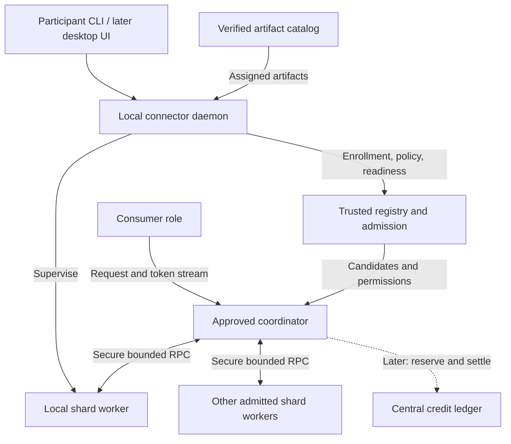

# Plan: participant connector and a global inference network

Prepared 2026-10-17. **Design proposal; no connector, GPU support, public service,
recovery system or credit system is implemented by this document.**
[PLAN.md](PLAN.md) remains the authority for research phases P0–P8;
[PYTORCH_PIPELINE_PLAN.md](PYTORCH_PIPELINE_PLAN.md) records implemented M0–M5.
The work packages below extend those plans without declaring their gates passed.

## 1. Objective and recommended direction

Build an application that lets a person use shared inference, contribute a
bounded portion of their machine, or operate an approved coordinator. A person
may consume and contribute simultaneously. Contributions should eventually earn
credits for accepted computation that can be spent on later inference, including
when that person's own machine is offline.

The recommended architecture is a **global pool of participants serving many
short, locality-aware model pipelines**. Each request uses a selected subset of
compatible machines. It does not traverse every device in the network. Extra
participants can host replicas of busy layer ranges, support additional complete
pipelines, or enable a larger model. A machine should host a useful contiguous
group of layers, sized from measurements; the smallest possible shard is not
necessarily the best contribution.

Keep the trusted coordinator and central registry for the first invited network.
Add a central ledger only after useful inference and bounded recovery are
demonstrated. Allow multiple approved coordinators next, then evaluate federation
and decentralized discovery. Permissionless correctness and accounting remain
separate research problems.

The immediate priority is a secure, reproducible two-device vertical slice and
one verified GPU backend. A polished desktop application follows a working
headless connector. This gives the project a concrete route from the current lab
to the intended community without assuming that worldwide distribution is faster
or cheaper.

## 2. Starting point: evidence and gaps

| Area | Present evidence | Required next capability |
| --- | --- | --- |
| Execution | Pinned tiny Llama; CPU float32/eager; resident layers and session KV caches | Explicit device placement, selected GPU stack, then a larger supported model |
| Correctness | Same-stack forced-token/logit comparisons, isolation and lifecycle checks | Repeat on actual devices, precisions, routes and recovery paths |
| Scheduling | Three fixed worker queues; independent requests overlap | Variable stage count, measured placement and multiple candidate workers |
| Coordinator | Tokenizer, embeddings, final norm/head, greedy sampling and streaming | Authenticated API; later separate control duties from model input/output execution |
| Transport | Bounded Protobuf/tensor gRPC in an isolated private lab | Identity, authorization, encryption, outbound connectivity and relay accounting |
| Availability | Watchdogs, bounded leases, explicit failure and cleanup | Registration, draining, capacity freshness and tested reconstruction of lost state |
| Participants | Compose services and thin benchmark client | Installable connector, local limits, diagnostics and understandable status |
| Economics | Research design only | Normalized accepted-work accounting, reservation and idempotent settlement |

The [P3 follow-up](experiments/2026-10-16-pytorch-p3-continuation.md) measured
pipeline throughput around 157–158 output tokens/s on its LAN subset and around
37 output tokens/s with the configured delay. A separate fresh matched-resource
comparison found complete-model replicas around 711–718 output tokens/s versus
157–159 for the pipeline. These are same-laptop CPU results for a tiny model;
the experiment sets use separately recorded images and must not be pooled.
They motivate measuring communication and retaining whole-model replica controls.

The [runtime guide](PYTORCH_RUNTIME.md) records that about 89% of this tiny model's
parameters live in the coordinator's input/output components. Its shard ratios
cannot predict the memory layout of a larger model. The
[capacity tool](PYTORCH_CAPACITY.md) checks explicit budgets; it does not establish
GPU execution fit. Only the local laptop is currently available.

## 3. What participants actually compute

For ordinary autoregressive generation:

1. A tokenizer converts a prompt to token IDs using a pinned tokenizer revision.
2. The embedding component maps those IDs to hidden vectors.
3. Consecutive layer groups transform those vectors. Each group retains its own
   layers' key/value attention cache for that session.
4. The final normalization and output head produce vocabulary scores. A sampler
   selects the next token according to the request's supported policy.
5. The token is streamed to the user and fed back through the embedding to begin
   that session's next decode step.

Workers cooperate on the same answer. They cannot independently calculate
successive tokens before the preceding token is known. Parallel work initially
comes from independent requests occupying different stages. Supported prompt
chunking/batching can improve utilization later, after new correctness gates.

Here, "embedding" means the model's input embedding computation. A separate
sentence/vector embedding API for search is a different product and model
contract. Tokenization, output-token generation and input embeddings should have
distinct names in the connector and accounting system.

### Component placement

| Component | First secure slice | Later option and tradeoff |
| --- | --- | --- |
| Tokenizer | Coordinator; consumer may submit validated token IDs | Local tokenization reduces text transfer but does not hide prompt content from computation |
| Input embedding | Existing coordinator | First execution stage; include its matrix and loading peaks in that host's budget |
| Transformer blocks | Fixed admitted workers | Measured contiguous ranges; replicas for bottlenecks and replacement capacity |
| Final norm/head/sampling | Existing coordinator | Last execution stage; return token events instead of transferring vocabulary logits every step |
| Session scheduling | Trusted coordinator | Local personal coordinator or an approved regional operator |
| KV caches | Workers owning the corresponding layers | Reconstruct on failure; migration requires an explicit validated cache format |

Keep the current placement as a control when changing it. Moving embeddings and
the head into first/last execution stages is a separate topology experiment.
If input and output weights are tied, colocating them may save a copy but add
communication; placing them apart requires explicitly budgeting identical copies.
Do not double-count tied weights within one process or assume they can be shared
across machines without cost. Full logits remain available in bounded validation
runs even if the normal client stream carries only selected tokens.

## 4. One connector, three independently enabled roles

| Role | What it does | Admission and requirements |
| --- | --- | --- |
| Consumer | Selects a model/trust group, submits a request, streams tokens, cancels and sees usage | User credential, request budget and compatible API; no GPU required |
| Host | Loads approved artifacts and executes assigned components for admitted sessions | Device credential, verified runtime/model, measured resources and enforced local limits |
| Orchestrator | Selects a route, reserves all stages, schedules work, owns output order and requests settlement | Coordinator credential and worker authorization; current design also needs memory/compute for embedding/head |

An ordinary participant can enable both consumer and host. Hosting is opt-in and
does not grant coordinator or ledger authority. If no useful assignment fits,
the application reports that honestly and remains usable as a consumer. Do not
force slow devices into an interactive pipeline merely to show participation.

Provide two eventual orchestration modes:

- **Personal:** the connector coordinates its owner's requests using workers
  that authorize it. It still needs model input/output resources until those
  operations move to execution stages. It cannot award itself public credits.
- **Community operator:** an admitted operator serves other users, with quotas,
  authenticated ingress, an uptime expectation, incident controls and approved
  ledger access. Public service operation is an explicit deployment choice.

To enable orchestration, the connector verifies input/output component capacity,
obtains the appropriate coordinator credential, loads a trusted model catalog,
selects an admitted worker pool and validates a complete route. Personal mode
binds its consumer API locally. Community mode additionally configures secure
ingress, consumer quotas and operational monitoring, then advertises readiness
only after route checks pass. The operator never receives a general-purpose
remote shell on worker machines or authority to bypass their local policy.

Support multiple roles on one machine with one shared resource controller.
Hosting, local inference, orchestration and multiple local worker processes must
not each reserve the same memory independently. The user can reserve a share for
their own work, drain external sessions or stop immediately. Local-only work has
no public reward unless it participates in a separately accounted transaction.

## 5. Connector architecture and user journey

### Process boundaries

Start with a Python CLI and daemon around the existing runtime. Keep the runtime
in its pinned container/environment and use a small management interface so a
desktop shell can be added without rewriting inference. Avoid choosing a new
native systems language before profiling demonstrates a need.

The daemon owns enrollment, resource policy, artifact installation, connectivity,
worker supervision and a loopback-only authenticated management API. It launches
the existing worker/coordinator entry points rather than duplicating model code.
A minimal desktop UI can later consume that API. Protect it against other local
users and unintended browser access; never bind management endpoints publicly.
Keep the consumer client/SDK free of PyTorch and model downloads. Install the
larger execution environment only when hosting or local model operations require
it; the current thin remote client is a useful starting point.

First platform target: the existing Linux amd64 environment. Select Linux GPU
support, and Windows through WSL2/containers if verified on the recruited
hardware. Native Windows, AMD, Apple Silicon, browser hosting and phones need
their own adapters and tests; the first installer must state supported platforms.

### Onboarding flow

1. Install a verified release and run local diagnostics. Report unsupported
   drivers/platforms and required disk/memory without silently changing them.
2. Choose consumer, host or both; orchestration is a separate advanced setting.
3. Create a device key in protected local storage, enroll with an invitation,
   and obtain a short-lived scoped credential. Separate user account identity,
   stable device identity and per-process boot identity.
4. Set maximum VRAM/RAM, disk cache, CPU use, bandwidth/data allowance, concurrent
   sessions, availability hours and idle-only behavior. Choose battery/temperature
   stop policy where reliable telemetry exists. Explain which limits are enforced
   and which measurements the platform cannot supply.
5. Run bounded opt-in hardware and network probes. Present download size and the
   proposed component assignment before installing model artifacts.
6. Download only the needed shard and required metadata from approved locations,
   verify their identities, load offline and pass a numerical readiness challenge.
7. Advertise readiness only after validation and resource reservation succeed.
   Show current assignment, active sessions, limits, traffic and accepted work.
8. Provide separate **Drain**, **Stop now**, and **Remove device** controls.
   Drain rejects new sessions and waits within a deadline; immediate stop may
   fail active requests. Removal revokes credentials and offers cache deletion.

Suggested CLI surface, **interface proposal only; these commands do not exist**:

```text
steamboat doctor
steamboat enroll
steamboat policy edit
steamboat host start
steamboat status
steamboat host drain
steamboat host stop
steamboat infer
steamboat orchestrator start --scope personal
steamboat leave
```

Enrollment secrets should be entered through a protected prompt/file channel,
not placed in shell history. The status view should explain states such as
"waiting for an assignment", "downloading", "ready", "paused by owner",
"insufficient memory" or "connection unavailable". Credit balances appear only
after a ledger exists; distinguish provisional work from accepted earnings.

### Resource enforcement and packaging

Keep inference processes unprivileged, restrict mounts and egress, mount verified
weights read-only and bound logs, disk growth, file descriptors and sockets.
Do not mount the Docker socket into workers or expose a remote shell/command API.
The host daemon is a privileged local trust boundary if it controls containers;
its remote management messages must be narrowly enumerated operations.

VRAM policy needs admission budgeting and measurements; a container RAM limit is
not a VRAM cap. Reserve caches before admission, account for runtime/temporary
allocations, monitor changing free memory and stop admission when budgets cannot
be met. Do not advertise hard GPU isolation or power control on unsupported
devices. Keep a margin for the owner's desktop and other processes.

Before distributing binaries, add signed update metadata, artifact hashes,
version compatibility checks, staged rollout, draining before upgrades and a
tested rollback path that does not restore a known-revoked version. Separate
code/image distribution from model redistribution and review their terms through
the existing [third-party process](THIRD_PARTY.md).

## 6. Control services and network topology

The first shared deployment needs a small trusted directory/admission service,
approved coordinators and an artifact catalog. A relay is optional according to
connectivity; the ledger is a later service. These are logical boundaries and
can initially share a deployment without becoming one unbounded process.



The diagram shows the initial coordinator-relayed route. Each network connection
may use an authenticated outbound tunnel when a worker is behind NAT. A later
direct route is `embedding -> stage 1 -> ... -> final stage -> token feedback`;
the coordinator still owns admission, sequencing, cancellation and settlement.

### Connectivity in three increments

1. **Fixed invited devices:** establish an authenticated encrypted private overlay
   or explicit TLS routes, with an allowlist. Add application-level peer identity
   and authorization; an IP address alone is not admission. Keep fixed assignments
   and existing failure semantics. Record whether the overlay relays traffic.
2. **Outbound connector:** each worker opens an authenticated persistent channel
   to its admitted gateway/coordinator. Implement a bounded multiplexed tunnel or
   explicit bidirectional work stream; existing unary server RPCs cannot receive
   work merely because the host made an outbound registration request. Test
   reconnect, flow control, idle expiry and gateway loss. Session mutation is
   still not automatically retried after an ambiguous disconnect.
3. **Optional direct peer path:** evaluate a maintained connectivity layer for
   reachability discovery, hole punching and relay fallback. Authenticate endpoints
   end to end, authorize each route and measure direct versus relayed paths
   separately. Record an architecture decision before adding this dependency.

The official [libp2p hole-punching](https://libp2p.io/docs/hole-punching/) and
[circuit-relay](https://libp2p.io/docs/circuit-relay/) documentation provides a
candidate pattern: establish reachability through a relay, then attempt a direct
connection. Direct connectivity is not guaranteed, and relay reservations can
limit bytes and lifetime. This is a design reference, not a decision to adopt
libp2p or rely on public relays for bulk inference traffic.

gRPC supports TLS and optional mutual certificate authentication, providing a
basis for the secure runtime path; application permission checks are still part
of this project's design. See the [gRPC authentication guide](https://grpc.io/docs/guides/auth/).

Do not remove the existing private-lab endpoint restrictions as a shortcut to
internet support. Add an explicit secure transport configuration, certificate
validation and authenticated DNS/IPv6 endpoint handling where supported. Current
`private_network=True` is not a security mechanism. Bound connection attempts,
handshakes, probes and relay use; workers must not be usable to probe arbitrary
private-network addresses on behalf of peers.

For the first outbound gateway, document the gateway as trusted if it terminates
transport encryption. An opaque relay with endpoint-to-endpoint encryption has
a different trust model. Either design still exposes computation to worker
owners. Budget relay bandwidth, egress, connection limits and availability;
relaying activations can become the largest infrastructure expense.

## 7. Registration, assignment and protocol contracts

Registration is a candidate advertisement, not proof of capacity or correctness.
The registry returns only admitted compatible candidates with bounded freshness.

| Contract | Proposed contents and checks |
| --- | --- |
| Node advertisement | Device/boot identity, runtime/protocol versions, supported backends, operator policy, model/component hashes, ready ranges, resource pools, limits and expiring reachability data |
| Measurement record | Who measured it, timestamp, workload/model/backend, local stage time, route RTT/goodput, memory peaks, uncertainty and expiry; separate reports from verified observations |
| Assignment lease | Authorized coordinator and worker, exact component/range, manifest/placement version, expiry, allowed operations, context/session/byte limits and resource reservation |
| Session open | Request/attempt ID, route epoch, tokenizer/model identity, context/output budgets, remaining deadline and per-stage lease; reserve every required component before execution |
| Step | Existing session/boot/lease, sequence, absolute position, shape/dtype/bytes and timeout; add authenticated tenant/route binding and payload identity before replay is introduced |
| Result/event | Validated step identity, committed position, token event index, completion state and bounded diagnostic durations; reject unsolicited/stale results |
| Work receipt | Later: accepted logical operation, attempt, component, tariff version, verification decision and unique settlement key; never a self-authorizing reward |

Use a stable node identity across restarts and a new boot ID per runtime instance.
Expiry/revocation must stop new admission. Maintain a bounded local freshness
window for existing permissions if the registry is unavailable; beyond it, fail
closed according to the published policy. Do not extend hard session deadlines
indefinitely because heartbeats continue.

Node lifecycle: `unenrolled -> enrolled -> probing -> loading -> ready -> draining
-> paused/offline`. Errors move to `unavailable` or `quarantined`; reentry requires
the relevant checks. A heartbeat means the control channel is alive, while
readiness additionally means verified weights, sufficient resources and a healthy
executor. A sleeping laptop or stale advertisement must disappear from placement.

Split **model identity** from **placement identity** when generalizing the current
manifest. Model/tokenizer revisions, artifact hashes, precision, backend and
tensor contract identify compatible computation. A placement version identifies
which admitted node owns each component. Replacement must not weaken model-hash
checks. Every complete route covers all layers in order with no gaps or overlaps.

Multiple coordinators require worker-enforced shared quotas, not independent
claims on the same free memory. Bind reservations to coordinator/tenant identity,
use atomic worker admission and release partial multi-stage reservations. Version
the wire schema explicitly; reject unsupported mixed deployments and test rolling
upgrades without reinterpreting existing sessions.

## 8. Placement, memory and communication

### Placement algorithm

Start with a fixed admitted topology and collect trustworthy profiles. Then:

1. Filter candidates by model/backend compatibility, trust group, resource policy,
   fresh readiness and sufficient memory for weights plus the requested caches.
2. Enumerate a bounded set of contiguous layer partitions and routes. Include
   embedding/head placement, coordinator resources and actual relay paths.
3. Estimate prefill/decode latency from measured compute, queues, serialization,
   transfer and token feedback. Include load time if any stage is cold.
4. Choose a route satisfying the request's budget; prefer warm compatible stages
   and low measured latency. Reserve it atomically from the request's perspective.
5. Pin active sessions to those stages. Change future admissions first; moving
   active sessions requires the recovery/migration protocol.

Score per-user latency and useful aggregate throughput separately. Measure links
between actual route endpoints; a worker's ping to the registry does not describe
its link to another worker. Geography can narrow candidates, but measured routes
decide. One slow stage limits sustainable capacity, so replicate that stage or
revise its range before adding unrelated shards. Avoid excessive reassignment:
model downloads and cold starts can erase the benefit of a better theoretical
partition.

Specify fairness before admitting competing users/coordinators: cap each tenant's
queued and active work, reserve an explicit bounded owner share and schedule the
remaining capacity fairly across admitted tenants. Owner preference must not
silently starve already admitted external sessions. Initially retain FIFO at
stage-call boundaries and bound prompt lengths, documenting that a long prefill
cannot be preempted. Add chunked prefill with decode-aware scheduling only after
numerical and lifecycle validation. Freeze service weights/quotas and test mixed
prompt lengths, owner requests and competing coordinators under saturation.

### Explicit memory budget

For each physical memory pool, require:

```text
resident weights + reserved KV + execution/allocator headroom
  + communication buffers + other local role reservations <= usable budget
```

Measure startup/conversion peaks separately; a shard that fits after loading may
still fail to load. Shared/unified memory and several processes on one GPU must
not be counted as distinct capacity pools.

For a conventional dense-attention cache, an illustrative uncompressed estimate
for one stage is:

```text
KV bytes = 2 * owned_layers * KV_heads * head_dimension * cache_element_bytes
           * sum(reserved_context_positions_for_each_session)
```

The factor two is keys plus values; grouped-query attention uses KV heads rather
than query heads. Backend metadata, paged-cache padding, temporary allocations,
quantization scales and architecture-specific state require additional budgets.
Measure the selected implementation instead of assuming this formula is exact.

For scale only, 70 billion parameters at four bits occupy about 35 GB in raw
weight payload before scales, other weights, caches or runtime overhead. This is
arithmetic, not a selected model, supported quantization mode or demonstrated fit.
Start with a smaller validated adapter and select the P4 model from real cohort
capacities. A P4 candidate must exceed each participant's measured single-device
GPU-resident capacity under the same model/precision/context configuration. If
a participant has multiple accelerators, also test the supported local multi-GPU
control using that machine's available resources. Claim a need for cross-machine
pooling only when no single participant machine can hold and execute the complete
configuration accelerator-resident; simple addition of advertised VRAM does not
establish either local or distributed fit.

### Why short routes matter

For dense uncompressed boundary activations with batch one:

```text
prefill payload per transfer = prompt_positions * hidden_width * element_bytes
decode payload per transfer  = hidden_width * element_bytes
decode time ~= sum(stage compute + queue time)
               + sum(actual transfer-leg latency and serialization)
               + embedding/head/sampling and token-feedback time
```

**Hypothetical example, not a benchmark:** hidden width 4,096 and two-byte
activations produce 8 KiB per decode transfer and 8 MiB for a 1,024-token prefill.
Transferring 8 MiB at 20 Mbit/s takes about 3.36 seconds before latency, protocol
overhead or compute. The present three-worker coordinator-relayed topology makes
six activation transfers per step: around 48 MiB for that hypothetical prefill.
If each of six sequential legs added 50 ms, network latency alone would be
300 ms/token, limiting one session to at most about 3.3 tokens/s before compute.

These assumptions are unrelated to the tiny checkpoint's actual hidden width.
They explain why worldwide membership should supply several suitable pipelines
and replicas. Use fewer/larger stages where memory permits. Direct forwarding,
compression, chunked prefill and batching each need separate measurements;
none removes a single session's causal token dependency.

## 9. Reliability and correctness under changing availability

Keep today's explicit fail-and-cleanup behavior as the first secure baseline.
Adding a reconnect loop must not change it into blind `Step` retries. A lost
response can mean the worker already changed its cache.

Introduce recovery in two controlled increments:

1. **Restart the request state from accepted token history.** Record the prompt
   and committed output prefix in the trusted session owner's bounded memory.
   Allocate fresh sessions on a replacement route and replay the prompt plus
   accepted tokens as forced inputs, without re-emitting historical output. Track
   the exact cache prefix and next-token position; streaming and cache advancement
   are not assumed to occur at the same instant. Retain sampler state if later
   supporting stochastic generation. This simple approach can be expensive but
   avoids transferring incompatible KV layouts.
2. **Selective stage reconstruction.** If recovery costs justify it, retain bounded
   stage-input checkpoints or introduce a versioned KV transfer format. Specify
   precision/layout compatibility, storage/privacy costs and exactly which
   downstream states are invalidated. Compare with whole-route reconstruction.

Use an append-only committed event index per request and a route epoch to reject
late results. A bounded output replay buffer can resend events after a client
reconnect; clients supply their last acknowledged event index and deduplicate by
request/event index. If the required suffix has already been evicted, return an
explicit resume-unavailable state rather than skipping events or silently starting
a new generation. Delivery is not magically exactly once across a broken network.
Preserve one logical accepted prefix and idempotent effects despite at-least-once
messages.

Recovery requires warm replacement weights or a budget that includes download
and load time. A second copy of weights is not a second copy of a live KV cache.
Record replica memory, reconstruction work, extra traffic and verification costs.
Stop when the retry count, request time, credit reservation or recovery budget is
exhausted; return the accepted partial prefix with an explicit failure state.

Test worker loss before/after admission, during prefill, after cache mutation but
before reply, after sampling but before delivery, and during cancellation. Also
test coordinator loss, relay loss, sleep/resume, credential revocation, OOM,
corrupt artifacts, expired output replay history and upgrade interruption.
Coordinator failover needs durable
session ownership/fencing and retained history; until implemented, coordinator
loss fails the request and leases reclaim state.

Petals provides prior research on heterogeneous layer serving and reconstruction
after failure, but its findings do not validate this runtime or its hardware.
See the [Petals systems paper](https://arxiv.org/abs/2312.08361).

## 10. Trust, privacy and accepted work

Separate three threats: the contributor's machine receiving hostile requests,
the consumer receiving incorrect computation, and the ledger accepting false
work. Transport authentication addresses identity and link integrity, not all
three threats.

For the invited network, retain a trusted registry, model catalog, coordinators
and ledger operator. Admit known participants, use public/synthetic prompts and
document that worker owners can inspect activations, weights and caches. Moving
tokenization or embeddings to the consumer does not establish prompt privacy.
Logs should exclude prompts, token histories and activations by default; opt-in
debug capture needs bounded retention and access control.

On worker hosts, accept only supported inference operations and approved signed
manifests. No pickle, arbitrary operator execution, peer-supplied Python or remote
model code. Validate sizes before allocation, tensor metadata, finite values,
positions, session identity, authorization and sequence. Fuzz malformed messages
and test resource exhaustion independently of numerical correctness.

For computation integrity, combine known enrollment, readiness challenges and
sampled comparisons against trusted execution. A stateful spot check must supply
or reconstruct the correct context; comparing a random decode step without its
cache is not a valid test. Establish numerical tolerances for each supported
precision/backend. Exact artifact hashes and acceptable numerical output are
different checks. Shape/finite-value checks alone cannot detect plausible wrong
answers.

Keep verification cost visible and bounded. Replication only helps under explicit
independence/trust assumptions. Signatures attribute receipts; they do not prove
correct computation or prevent collusion. Prompt/activation digests can also leak
information and should not become public telemetry. The
[Petals security guidance](https://github.com/bigscience-workshop/petals/wiki/Security,-privacy,-and-AI-safety)
describes related privacy and malicious-peer limitations.

Before open enrollment, require an adversarial review of malicious workers,
coordinators, forged capacity, identity farming, grant abuse and denial of service.
Choose an explicit service trust tier: invited operators, trusted communities or
an experimental untrusted pool. Reputation alone is not permissionless proof.
Confidential execution or cryptographic verification would be separately scoped
research, with measured overhead, rather than assumed features.

## 11. Reciprocal credits after useful inference

Begin with non-monetary service credits in a trusted central double-entry ledger.
Define their purpose as access to accepted service, without promising cash value,
profit or equal purchasing power across future tariffs. A blockchain is not
required to test reciprocity and would not prove the inference was performed.

1. Publish a versioned tariff based on calibrated reference work for a model,
   component/range, prefill/decode, context bucket and supported precision. Include
   embedding/head work where material. Do not pay solely for token count, claimed
   elapsed time, GPU brand or advertised idle capacity.
2. Estimate and reserve the consumer's maximum charge before admitting the request.
   Stop or request a new authorized budget before exceeding that reservation.
3. Accept authenticated operation records according to the stated verification
   policy, then settle unique logical work units. Bind the deduplication key to
   request, logical step, component and tariff; keep attempts separately so a new
   attempt ID cannot mint another normal reward for the same work.
4. Release unused reservation after completion/cancellation. Reconcile crash
   recovery between event recording and settlement; transaction boundaries and
   unique constraints must make settlement repeatable.
5. Record grants, user charges, host rewards, coordinator/relay fees, verification,
   recovery and retired credits explicitly. Subsidized recovery is a separate
   budgeted work class, not a hidden duplicate reward.

Publish a policy table for partial failures: whether correctly accepted upstream
work is rewarded, who bears failed/recomputed work and what a cancelling consumer
owes. Users must be able to inspect their accepted operations and contest errors.
Keep worker-owned self-reports separate from coordinator acceptance and ledger
authorization. An untrusted personal orchestrator cannot independently settle
public rewards.

Test replayed receipts, repeated settlement after crashes, simultaneous spending,
refunds, malicious coordinators, colluding consumers/hosts and repeated new-account
grants. Self-serving traffic may transfer existing credits but must not create
net credits. Any grant issuance must be explicit and bounded. Measure whether
contributors can use earnings when they want inference; idle supply alone does
not guarantee demand, availability or useful purchasing power.

## 12. Implementation work packages and acceptance gates

These are proposed connector work packages, **not new names for M0–M5 or proof of
P0–P8 completion**. Contract/tooling work can start on one laptop; device gates
require actual participating machines. Do not block every implementation task on
the full historical sweep, but preserve its incomplete coverage and freeze new
comparisons before collecting them.

| Package | Deliverable | Prerequisite | Acceptance evidence |
| --- | --- | --- | --- |
| C0: Freeze connector contracts | Role/policy schema, identities, threat model, platform choice and experiment manifest | Current baseline | Reviewed contracts; explicit unsupported features; unchanged legacy lab |
| C1: Secure fixed cohort | TLS peer identity/authorization, bounded admission, enrollment/revocation and fixed-device deployment | C0 | Unknown/wrong-role/expired peers rejected; forced-token and lifecycle parity across two physical devices |
| C2: Headless connector | Diagnostics, resource policy, verified install/load, daemon supervision, outbound work channel, drain/stop | C1 secure interfaces; hardware access can follow local contract tests | Clean install; no inbound router setup on tested route; forced disconnect/stop/restart bounded; limits and artifact corruption checked |
| C3: One GPU backend | Isolated lock, device-aware layers/cache/tensors, synchronized timings and same-stack reference | Confirmed hardware; C1 for remote checks | Finite logits within justified frozen tolerance; actual peak VRAM/loading measured; isolation and cancellation passed |
| C4: Flexible placement and real links | Model/placement identity split, variable ranges/stages, measured link profiles and same-host controls | C2, C3 | Exact coverage; correct 1/2/3-stage supported cases; LAN/WAN/direct/relay results; mixed-length/tenant fairness and resource costs |
| C5: Pooled-memory demonstration | One larger pinned adapter/model and same-model offload control | C3, C4 and suitable devices | Useful requests under frozen criteria; no single participant machine can execute the complete configuration accelerator-resident, including supported local multi-GPU controls; all memory pools and overhead included |
| C6: Churn and recovery | Shared admission, draining, replicas, replay semantics and bounded reconstruction | C4; expansion decision after C5 | Fault matrix preserves accepted prefix, no duplicate effects, bounded cleanup/recovery with measured costs |
| C7: Credits and operator controls | Central ledger, tariffs, settlement, audit/dispute records and approved coordinator admission | C5, C6 | Accounting invariants, crash/replay/abuse tests and overhead measurements |
| C8: Desktop and invited pilot | Thin UI, signed distribution/update path, diagnostics and participant support | C2 UX can start earlier; pilot requires C5–C7 | Target 10–20 invited participants subject to recruitment; installation/reliability/fairness/benefit report and continue/revise/stop decision |
| C9: Federation and open-network research | Multiple trust domains, discovery resilience and explicit settlement boundaries | Successful C8 and adversarial review | Measured benefits survive coordination/verification costs; remaining trusted functions named |

Use engineering owners by responsibility: runtime/GPU, connector/network,
benchmark/research and ledger/security. These need not be separate people.
Set dates and staffing only after confirming contributors and hardware; task
dependencies are more credible than a promised public-launch date today.

### Repository implementation map

All new paths below are proposals, not existing entry points.

| Existing area | Proposed change |
| --- | --- |
| `src/steamboat_runtime/protocol/transport.py`, `remote_client.py`, `coordinator_service.py` | Add explicit secure paths and authorization while retaining private-lab configuration; disable implicit retries for mutation |
| `src/steamboat_runtime/manifest.py`, `prepare.py`, `model.py`, `coordinator_model.py` | Separate model and placement schemas, component ownership, supported adapter/device contracts and verified loading |
| `src/steamboat_runtime/coordinator.py`, `worker_state.py`, `supervisor.py` | Generalize fixed stages, shared quotas, draining, later route epochs/recovery; preserve cleanup invariants |
| Proposed `src/steamboat_connector/` | CLI, daemon, device identity, resource policy, artifact management and connectivity adapters |
| Proposed `src/steamboat_control/` | Admission, expiring registry and placement services; keep ledger integration a separate boundary |
| Proposed `src/steamboat_ledger/` | Later tariff/reservation/settlement service and append-only accounting events |
| `lab/device_inventory.py`, `network_probe.py`, `pipeline_benchmark.py`, `experiment_audit.py` | Device pool identity, real-route measurements, capacity/recovery cost and new configuration provenance |
| `tests/runtime/`; proposed `tests/connector/`, `tests/control/`, `tests/ledger/` | Numerical/lifecycle regression, authentication and policy, connection faults and accounting invariants |
| `docker/pytorch/`; proposed separate GPU image/lock and cohort configuration | Preserve CPU/Petals reproducibility; add pinned GPU and participant packaging separately |
| `docs/decisions/`, `docs/experiments/` | Architecture choices before implementation; compact sanitized evidence after executed gates |

### First reviewable changes, in order

1. Write the identity/role/resource schemas and secure-transport decision. Specify
   enrollment, revocation, TLS trust roots and who may invoke each operation.
2. Implement secure fixed-worker and coordinator clients/servers with negative
   authentication tests. Keep the old isolated lab reproducible.
3. Add connector `doctor`, policy and status against local supervised workers;
   test conflicting reservations, drain and emergency stop.
4. Add enrollment, expiring readiness and one outbound work path; test with fake
   workers and network failures before running real-model parity.
5. Recruit/inventory a second device and execute the secure fixed-route parity
   report. In parallel, select and validate the first available GPU backend.
6. Generalize the hard-coded three-worker/one-model assumptions behind explicitly
   supported manifests. Validate smaller partitions before selecting a P4 model.
7. Freeze and execute a bounded real-device comparison with the existing controls.
   Decide from those results whether direct links, chunked prefill or placement
   work provides the largest next benefit.

This order produces a useful contributor interface early while keeping expensive
model expansion, recovery and economics attached to measured gates.

## 13. Experiments, targets and decisions

Before each experiment, pin model/tokenizer revisions and hashes, runtime/image,
precision/quantization, attention backend, compression, sampler, topology,
hardware, resource limits and workload. Preserve numerical fixtures, warm-up,
arrival pattern, seeds and failed attempts. Treat scheduler changes and direct
forwarding as new configurations rather than merging their results.

| Question | Experiment/control | Evidence to retain |
| --- | --- | --- |
| Does the connector preserve computation? | Identical prompt tokens and forced continuation against the complete model; interleaved sessions and boundaries | Logit errors, finite outputs, context/lease checks, cleanup and explicit skips |
| Does distribution help? | Whole-model replicas when it fits; same-model CPU/RAM offloading when it does not | Client p50/p95 TTFT and intervals, completed-output throughput, failures and full resource inventory |
| Which route is useful? | Same-host, separate LAN, separate internet; fixed star versus direct only after parity | Actual route RTT/goodput/jitter/loss, bytes including relay and token feedback |
| Does scale improve capacity? | Stage replicas and independent sessions; later controlled arrival-rate sweep | Saturation, rejection rates, per-user fairness and coordinator/relay bottlenecks |
| Does recovery preserve service? | Frozen fault scenarios and failure rate; fail-and-cleanup control | Accepted prefix, duplicate detection, recovery tails, extra memory/bytes/work |
| Is contribution worthwhile? | Invited pilot after accounting gate | Install time, owner disruption, uptime, accepted work, usable credits, infrastructure and measured energy costs |

Retain the existing selected-run protocol: three repetitions targeting at least
100 completed requests within 200 attempts per repetition. Report underfilled
runs and failures. Short fault tests and installation trials are different
evidence, not replacements for performance repetitions. Observe client elapsed
times with a monotonic clock; synchronize GPU work for timing. Do not subtract
timestamps from separate hosts without measured clock uncertainty.

The existing **provisional** P4 target is a 1,024-token prompt, 64 generated tokens,
one active session, median decode rate at least 5 output tokens/s and p95 first
token within 5 seconds. Freeze or revise it with the actual cohort before running.
It is not a promise or a passed gate. Set separate concurrency, success-rate,
recovery and resource-cost targets before those experiments; do not invent
acceptable ceilings after observing results.

Decision rules:

- If a whole model fits and replicas win, use replicas for that model/cohort;
  keep partitioning focused on capacity otherwise unavailable.
- If communication dominates, test fewer stages, better measured locality or
  asynchronous workloads. Report if interactive targets remain infeasible.
- If no nontrivial shard fits or its compute/link is too slow, allow consumer-only
  operation; evaluate other contribution types only as separate measured products.
- If pooled memory works but failure recovery erases its benefit, restrict the
  admitted availability class or pause expansion while retaining the finding.
- If audit, relay and operational costs exceed useful service, revise the model
  or stop the public-service hypothesis. A negative result is valid evidence.

## 14. Public growth and remaining decisions

Grow through fixed trusted devices, a measured GPU cohort, an invited pilot and
multiple approved community operators. Global discovery should eventually index
model/range availability without requiring every node to maintain every peer.
Use bounded candidate lists, expiry and regional/control partitions. Schedule
from actual reachable capacity; do not confuse registered device count with
usable model coverage or available requests per second.

Federation needs explicit trust roots, quotas, session ownership and cross-domain
settlement. Discovery, scheduling and accounting may be decentralized independently.
Keep central accounting while testing federated serving if that answers the
project's goal. Only pursue unrestricted admission after stating how wrong
computation, identities, spam and collusion are handled and which guarantees are
still absent.

Before C1/C3 implementation, resolve: actual second-device access; initial supported
GPU/backend; who operates enrollment and gateway infrastructure; resource/egress
budget; and the fixed cohort's model/trust policy. Before C5, select the larger
model and verify its distribution terms and measurable offload control. Before
C8/C9, decide support ownership, abuse response, retention and operating costs.

While only one laptop is available, useful authorized development includes
schemas, local TLS/admission tests, connector lifecycle, fake-worker fault
fixtures, packaging diagnostics and bounded remaining CPU experiments. Label
separate-device, pooled-GPU and community findings as pending until real evidence
exists. Update [PLAN.md](PLAN.md) with each measured result, without converting
this design document into an experiment report.

## Primary references

Reviewed for this plan on 2026-10-17. They inform design choices, not claims about
this repository's performance. Freeze dependency versions when implementing.

- [Petals systems paper](https://arxiv.org/abs/2312.08361): prior work on uneven
  devices, contiguous block serving and failure recovery; different tested models
  and infrastructure from this prototype.
- [Petals security guidance](https://github.com/bigscience-workshop/petals/wiki/Security,-privacy,-and-AI-safety):
  threat-model context for volunteered computation and intermediate activations.
- [gRPC authentication](https://grpc.io/docs/guides/auth/): supported transport
  credentials and mutual authentication; the application must define permissions.
- [libp2p hole punching](https://libp2p.io/docs/hole-punching/) and
  [circuit relay](https://libp2p.io/docs/circuit-relay/): reachability and relay
  patterns to evaluate behind an explicit connector transport boundary.
