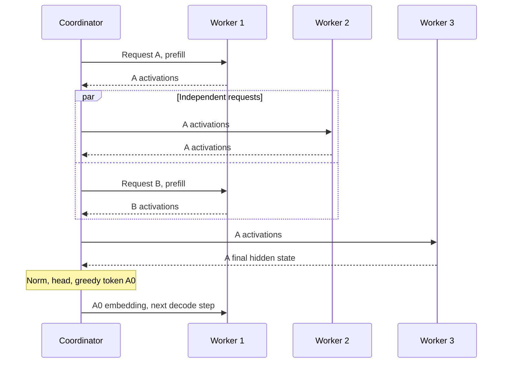

# Bounded coordinator and request scheduling

M4 adds an owned coordinator above the [three fixed workers](PYTORCH_WORKERS.md).
It owns tokenization, embeddings, final normalization, output projection, greedy
sampling, session admission and streamed results. Workers continue to own their
assigned layers and per-session KV caches. The coordinator relays activations
between stages through the existing binary protocol.

The [M4 experiment](experiments/2026-10-15-pytorch-m4.md) passed 179 tests and
144 remote logit comparisons, including verified compute overlap with eight
concurrent requests. These results establish correctness and scheduling mechanics.
M5 network sweeps, the thin remote benchmark client and performance comparisons
remain separate work.

## Scheduling and limits

Before accepting work, the coordinator verifies all three worker identities,
assignments, model fingerprints, resource limits and readiness. Each admission
reserves the same session on all workers. Partial admission cleans up earlier
reservations. An ambiguous response never causes a Step retry; the request fails,
known reservations are cancelled, and an unreachable worker's bounded lease is
the final cleanup mechanism. Restarted workers invalidate their previous leases.

Each worker has one coordinator dispatch loop and a FIFO queue. A request enters
worker 2's queue only after worker 1's reply has passed validation, then proceeds
to worker 3. The coordinator produces a token only after worker 3 finishes.
It feeds that token back through the embedding before the request starts its next
decode step. Different requests can occupy different workers at the same time.



The default manifest allows eight active requests, 32 waiting admissions, eight
queued operations per stage and 16 buffered output tokens per request. Admission
has a 30-second budget from submission, including queue wait, renewed preflight
and all three session reservations. Each RPC has at most 30 seconds, and the whole
generation budget at most 300 seconds from submission, including admission.
Worker cleanup can add up to 20 seconds before `result()` resolves. A full output
queue that does not drain within 30 seconds cancels the consumer's request. These
are resource bounds, not latency targets.

Renewal every 30 seconds keeps admitted sessions alive while waiting for another
stage or output capacity; it never extends their original hard lifetime. Deadline,
explicit cancellation and shutdown propagate to stage queues and worker leases.
Running compute retains cache ownership until it finishes or the M3 supervisor
restarts its process after the cancellation grace. Cleanup acknowledgement reports
whether reclamation was confirmed. It polls for up to 20 seconds (the worker's
15-second compute cancellation grace plus five seconds); unknown or unreachable
leases yield `cleanup_complete=False`, with bounded expiry as the fallback.

Prompts are bounded and unchunked. FIFO fairness applies at stage-call boundaries;
a long prefill cannot be interrupted to serve a short decode. M4 has no batching,
prefill chunking, dynamic placement or replay recovery. Captured logits are an
explicit validation option and contain only the final position's vocabulary
vector. The default streamed result carries tokens and timing metadata.

## Python interface

The coordinator is an asynchronous Python service object. It does not expose a
public network listener in M4. The following example assumes the pinned artifacts
and tokenizer are already prepared, as in [PYTORCH_RUNTIME.md](PYTORCH_RUNTIME.md).

```python
from steamboat_runtime.coordinator import Coordinator
from steamboat_runtime.coordinator_model import CoordinatorModel
from steamboat_runtime.manifest import load_manifest
from steamboat_runtime.protocol.transport import GrpcClient

manifest = load_manifest("/artifacts")
model = CoordinatorModel.from_artifacts("/artifacts")
clients = [GrpcClient(f"worker-{i}:50051", private_network=True) for i in (1, 2, 3)]
coordinator = Coordinator(manifest, clients, model)
try:
    await coordinator.start()
    ids = await model.tokenize("A public test prompt")
    handle = coordinator.submit(ids, new_tokens=8)
    async for event in handle:
        print(event.index, event.token_id)
    result = await handle.result()
    assert result.cleanup_complete
finally:
    assert await coordinator.close(), "Coordinator model thread needs process restart"
```

The coordinator owns its clients and model and closes them on shutdown. Model
operations run in one dedicated executor thread with at most eight accepted
operations. Cancelling an await retains its slot until the underlying operation
finishes. `close()` reports `False` if the model thread cannot drain within its
15-second grace; it cannot kill a running CPU kernel. A standalone process
supervisor for the coordinator is future service-deployment work.

`CoordinatorClient.generate()` accepts text or token IDs and streams the same
events. Explicitly close its async generator when abandoning it, for example with
`contextlib.aclosing`, so its `finally` block cancels the request. Text input is
limited to 64 KiB of UTF-8 and 1,152 tokens without truncation. Optional tokenization
precedes `submit()`, so it is outside submission-based admission and request clocks.
The combined prompt and requested output must fit the 1,152-position limit.

For explicit cancellation use `await handle.cancel()`. The request result records
status, produced output tokens, cleanup confirmation, error and submission,
admission and completion times. Its `token_ids` includes enqueued tokens even if
cancellation discarded them before the consumer received them. Fixed-length
validation runs do not stop early at EOS. Do not count prompt tokens as generated
output.

`forced_tokens` is a correctness-only feedback option: for nine output evaluations,
provide eight fixed tokens that are fed into the successive decode steps. Emitted
tokens remain the greedy selections for each forced context. A separate run with
no forced feedback verifies genuine autoregressive greedy generation.

## Reproduce the checks

Run these commands from the repository root in PowerShell with Docker Desktop's
Linux engine. They are the M4 procedure; consult the experiment record for the
actual commands and outcomes collected on this laptop.

```powershell
docker compose -f compose.pytorch.yaml build prepare
docker compose -f compose.pytorch.yaml run --rm prepare
docker compose -f compose.pytorch.yaml run --rm tests
docker compose -f compose.pytorch.yaml up -d --wait worker-1 worker-2 worker-3
docker compose -f compose.pytorch.yaml run --rm --no-deps coordinator-check
```

The `coordinator-check` service is an offline test driver with the additional
complete-model control loaded in its process. Its CPU and memory include that
control and must not be mistaken for production coordinator measurements. Worker
resources and private-network restrictions remain those documented for M3.
No Petals component is required. `STEAMBOAT_COORDINATOR_TESTS=1` enables the
real-model in-process coordinator integration tests in the offline test service.

The remote driver writes a unique `*-m4-coordinator.json` report into ignored
`.lab/pytorch-results/` on success or failure. It preserves the frozen
`atol=1e-3, rtol=0` tolerance, float32 eager attention, exact model/artifact pins and
runtime versions. Reference calculations occur before each concurrent cohort so
they do not block the scheduler during the overlap interval.

Validation compares every vocabulary logit at the last prefill position and each
of eight forced decode steps. Cohorts include 1, 3 and 8 simultaneous requests,
unequal contexts, and prompts of 1, 128 and 1,024 tokens. The separate greedy case
checks all nine output tokens against the complete model. M1–M3 retain the
every-prefill-position and exact-context-boundary checks. Live session counts,
cache bytes, reservations and queued operations must return to zero after each
cohort. Tests also cover cancelled streams and bounded scheduler failure paths.

## What the trace proves

The coordinator retains a bounded ring of 8,192 trace events with local monotonic
dispatch and response times. Each successful worker reply includes the start and
end of the actual inference-thread compute span. Queue wait and RPC time are
separate observations; overlapping RPC intervals alone do not prove simultaneous
model computation.

Before comparing worker spans, the validation driver requires a matching Linux
boot ID and monotonic offset from `/proc/self/timens_offsets`, and brackets each
worker's sample between the coordinator's request and response times. It refuses to
claim overlap if any clock check fails. It also verifies every request's exact
worker-1 → worker-2 → worker-3 → next-token order, one unresolved call per worker,
and actual positive compute overlap between different requests on different
workers in the concurrency-eight cohort. No artificial delay is injected into
that numerical run.

Docker may assign distinct time-namespace IDs while keeping equal clock offsets.
Offsets are defined relative to the initial namespace, so equal offsets on the
same kernel boot identify a shared monotonic time base. See
[Linux time_namespaces(7)](https://www.man7.org/linux/man-pages/man7/time_namespaces.7.html).

This establishes same-host scheduling mechanics. It does not establish speedup,
separate-device throughput, a useful WAN operating envelope or a pooled-memory
benefit. Real hosts need clock synchronization with a stated uncertainty before
their absolute compute timestamps can be compared. M5 supplies the controlled
network and benchmark work needed for performance conclusions.
