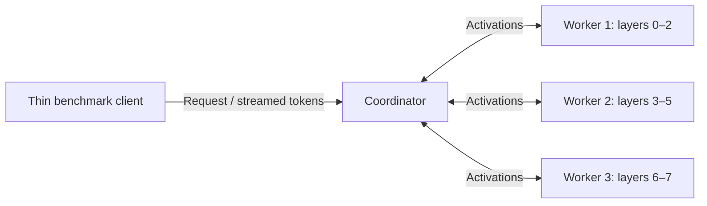

# Private PyTorch network experiment lab

M5 adds a standalone coordinator, a thin remote benchmark process and controlled
packet shaping to the [M4 scheduler](PYTORCH_COORDINATOR.md). All inference runs
inside one Docker Desktop Linux VM. This simulates network conditions between
processes; it does not establish performance on separate consumer devices.

The [M5 validation report](experiments/2026-10-16-pytorch-m5.md) records the passing
lab gate, selected network measurements and the remaining performance sweep.
The [P3 follow-up](experiments/2026-10-16-pytorch-p3-continuation.md) adds repeated
delay10 measurements, immutable continuation and matched-budget replica controls,
including retained setup failures and explicit separation of runtime images.

The runtime still uses the pinned CPU checkpoint, float32 eager attention and
fixed layer assignments in [PYTORCH_RUNTIME.md](PYTORCH_RUNTIME.md). Workers keep
their weights and session caches resident. The coordinator owns tokenization,
embeddings, normalization, output projection, greedy feedback and session leases.
The benchmark process receives tokens and records their arrival on its own
monotonic clock. It does not load model weights.



All three worker exchanges pass through the coordinator. Shaping applies to the
coordinator and workers' `eth0` egress queues. It also affects coordinator-to-client
token delivery. The driver itself is unshaped. These routes must be included when
interpreting configured delay and bandwidth limits.

## Coordinator service interface

`steamboat.v1.Coordinator` uses gRPC with bounded UTF-8 JSON messages for `Describe`,
`Tokenize` and streamed `Generate`. Worker-to-coordinator activations continue to
use the binary Protobuf protocol. Generate accepts token IDs, a fixed output count,
a deadline and optional forced feedback/logit capture for validation. Unknown
request fields, invalid IDs, oversized input, duplicate JSON keys, excessive
nesting and nonfinite numbers are rejected. No executable object deserialization
is used. A token event carries session, sequence, index, absolute position and ID;
a terminal result reports status, produced IDs, cleanup and bounded timing counters.
Per-request counters cover all stage calls. A partial trace retains the first six
and last six stage events; it is labelled as a sample, not a complete event history.

The service caps active client streams at 40, including pending admissions and
disconnected streams awaiting cleanup. M4's eight active sessions, 32 waiting
admissions and 16-token output queues remain in force. Transport writes have their
own 30-second stall bound. The remote RPC deadline includes admission, unlike the
separate optional Tokenize call. A deadline or broken connection may prevent the
terminal message from reaching the client; the client reports explicit failure,
and server-side cleanup remains independently owned.

The coordinator runs under the independent process supervisor. Its model executor
publishes deadlines before submitting CPU work, retains cancelled running calls,
and gives the watchdog the original 15-second compute cancellation grace. Normal
process shutdown has a separate 40-second ceiling to allow worker cleanup and
model draining. Worker failures stop admission; known sessions receive bounded
cleanup before coordinator replacement. Idle worker boot changes also invalidate
readiness. Restarts fail affected streams; no Step is replayed automatically.

```python
from contextlib import aclosing
from steamboat_runtime.remote_client import RemoteClient

async with RemoteClient("coordinator:50052", private_network=True) as client:
    ids = await client.tokenize("A public test prompt")
    async with aclosing(client.generate(ids, new_tokens=8)) as stream:
        async for event in stream:
            print(event)
```

Explicitly close an abandoned async generator so cancellation reaches the service.
The benchmark requests `add_special_tokens=False` for its repeated fixture,
matching the complete-model control exactly. User text tokenization defaults to
the tokenizer's normal special-token behavior.

## Build and validate

Run from the repository root using Docker Desktop's Linux engine:

```powershell
docker compose -f compose.pytorch.yaml build prepare
docker compose -f compose.pytorch.yaml run --rm prepare
docker compose -f compose.pytorch.yaml run --rm tests
docker compose -f compose.pytorch.yaml up -d --wait worker-1 worker-2 worker-3 coordinator pipeline-benchmark
docker compose -f compose.pytorch.yaml run --rm --no-deps service-check
```

The preparation command verifies or downloads pinned public artifacts. Subsequent
inference services use read-only verified artifacts with offline loading. The
`service-check` validation process also loads a complete-model control on the same
stack; its memory and CPU are separate from the thin benchmark's budget. It must
pass before interpreting benchmark results. Existing M1–M4 checks remain available.

The private network has no published ports. The coordinator and workers each have
two CPU quota units and 3 GiB RAM; the thin driver has one CPU quota unit and 1 GiB
RAM. CPU quotas are ceilings rather than dedicated cores. Only the four services
whose egress is shaped have `NET_ADMIN`. The Petals Compose project and its results
remain independent.

## Measure a workload

```powershell
docker compose -f compose.pytorch.yaml exec -T pipeline-benchmark python -m lab.benchmark bench --backend pipeline --coordinator coordinator:50052 --prompt-tokens 128 --new-tokens 8 --concurrency 3 --requests 6 --label m5-lan-smoke
docker compose -f compose.pytorch.yaml run --rm benchmark python -m lab.benchmark bench --backend pytorch --mode local --prompt-tokens 128 --new-tokens 8 --concurrency 3 --requests 6 --label m5-local-smoke
```

The public repeated-text fixture, fixed output count, greedy sampling and ignored
EOS policy are unchanged. Warm-up and loading are excluded from the measured
request interval. First-token latency includes the RPC, coordinator admission and
prefill; decode intervals use arrival times at the remote client. Prompt tokens
are excluded from output throughput. Failed attempts and their partial output are
retained separately, and no failed operation is silently retried.

The complete-model control uses the same Python and model stack but fewer aggregate
CPU quota units than the pipeline. It is a correctness and latency reference.
Resource-matched whole-model replicas are needed before making efficiency claims.
Historical Petals runs use their recorded older dependencies and topology; they
must not be treated as a matched runtime comparison.

### Complete-model replica control

The optional `replica-1` through `replica-4` services each retain a complete copy
of the same pinned model, with two CPU quota units and 3 GiB RAM each. Their
aggregate eight CPU units and 12 GiB memory ceiling match the three workers plus
coordinator. Both topologies use the same one-CPU, 1 GiB thin client. This matches
configured budgets, not dedicated cores or measured energy use. Four full weight
copies and replica-local KV caches differ from the pipeline's partitioned weights
and layer-local caches; the replica control needs no separate coordinator.

The `matched` benchmark backend uses the same remote token timing, public fixture,
closed-loop arrival policy and completion/attempt limits as `pipeline`. It warms
all replicas before the shared measurement interval. The client dispatches each
independent request to a least-loaded replica, rotating ties. The existing local
two-CPU control remains available.

Run controls separately from pipeline measurements. After the pipeline finishes
and its network reset is verified, stop its inference services, start all four
replicas, and run `scripts/Invoke-MatchedControl.ps1 -ExpectedImage sha256:...` with
the actual image ID. The script freezes three LAN repetitions at 128 input / 64
output tokens and concurrency three, runs a numerical/lifecycle check, retains
attempts and cgroup observations, and verifies per-replica resets. Its output
belongs to a separate `matched-*` directory. Stop replicas before restarting the
pipeline. The control's direct client-to-replica route is a different topology;
do not treat it as a shaped multi-hop network measurement.
The pipeline auditor does not accept the control plan schema; review its saved
gate, benchmark, resource and reset records separately as in the P3 report.
Control probes explicitly use port 50054, separate from replica RPC port 50053.

## Shape and measure the network

```powershell
.\scripts\Set-NetworkProfile.ps1 -ComposeFile compose.pytorch.yaml -ProjectName steamboat-pytorch-m1 -Services worker-1,worker-2,worker-3,coordinator -StatusOnly
.\scripts\Set-NetworkProfile.ps1 -ComposeFile compose.pytorch.yaml -ProjectName steamboat-pytorch-m1 -Services worker-1,worker-2,worker-3,coordinator -Profile custom -DelayMs 10
.\scripts\Set-NetworkProfile.ps1 -ComposeFile compose.pytorch.yaml -ProjectName steamboat-pytorch-m1 -Services worker-1,worker-2,worker-3,coordinator -Profile lan
```

Always restore LAN conditions in `finally` when composing your own experiment.
The experiment runner automates preflight, profile application, measurement,
failed-run retention and reset verification. It freezes its run order before the
first measurement. Read its help and generated plan before a large sweep.
Reset attempts each target independently, so a stopped worker cannot prevent
cleanup on surviving services. Any unverified target still fails the experiment;
per-target errors and the original inference failure are retained separately.

```powershell
.\scripts\Invoke-PytorchExperiment.ps1 -Mode Smoke
.\scripts\Invoke-PytorchExperiment.ps1 -Mode Full -PlanOnly
# A declared subset, still with three repetitions and the completion/attempt bounds:
.\scripts\Invoke-PytorchExperiment.ps1 -Mode Full -Profiles lan -PromptTokens 128 -Concurrencies 3
```

The runner writes uniquely named directories under `.lab/pytorch-results/` and
never overwrites previous evidence. Full runs may finish up to `concurrency-1`
requests above their completion target because already-started requests are
allowed to finish; the attempt ceiling is never exceeded. Container memory peaks
are cumulative since container creation, not reset between cases.

Configured delay is additional delay at each selected sender. Configured bandwidth
is a cap. The bounded TCP probe measures round-trip exchange time and achieved bulk
transfer rate between the coordinator and each worker before inference; report
those observations separately from requested settings. The probe is private,
temporary and carries synthetic bytes only.

## Scope of conclusions

The initial smoke protocol uses 128 input / 8 output tokens at concurrency one and
three, plus a 1,024 input / 64 output token capacity case at concurrency eight.
Separate delay-only, rate-only and combined profiles test the harness and reset
path. Smoke observations cannot establish latency percentiles or a useful WAN
operating envelope.

The prescribed performance protocol uses 128/1,024 input tokens, 64 output tokens
and concurrency 1/3/8. It requires three repetitions and at least 100 completed
requests per selected configuration, stopping each repetition at 200 attempts if
the target is not met. Retain failed and underfilled repetitions. Sweep added
egress delay at 0/10/25/50 ms independently of rates at 20/100/1,000 Mbit/s, then
selected combinations. Report balanced order, host contention, resource budgets,
network measurements, queue/compute/wire costs and verified reset. Label any
uncollected part of that matrix as remaining work.

The lab trusts its local worker and coordinator services. RPC has no authentication
or encryption. It does not implement arbitrary peer admission, recovery by replay,
GPU execution, reciprocal credits or a pooled-memory capacity demonstration.
