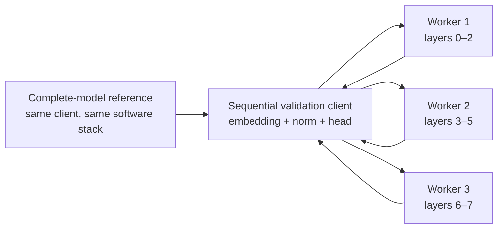

# Three fixed PyTorch worker services

M3 moves the [M2 handler and protocol](PYTORCH_PROTOCOL.md) into three supervised
worker services. Each service loads only its assigned model layers and owns its
session KV caches. A sequential validation client relays activations and compares
the final logits with the complete model. The subsequent [M4 coordinator](PYTORCH_COORDINATOR.md)
adds request scheduling, local streaming and verified overlap of independent requests.
This page describes the sequential M3 validation path.

The three-container numerical check passed on 2026-10-15: 48 comparisons had a
maximum absolute logit difference of `3.337860107421875e-6`, within the frozen
`1e-3` tolerance. All recorded cleanup checks returned zero live sessions, queued
calls and cache allocations. See the [M3 experiment report](experiments/2026-10-15-pytorch-m3.md)
for process-test results, resource observations and the exact validation commands.

## Topology and trust

| Service | Resident model components | Container limits |
| --- | --- | --- |
| `worker-1` | Global layers `[0,3)` | 2 CPUs, 3 GiB RAM |
| `worker-2` | Global layers `[3,6)` | 2 CPUs, 3 GiB RAM |
| `worker-3` | Global layers `[6,8)` | 2 CPUs, 3 GiB RAM |
| `remote-check` | Embeddings, final normalization and head; additional complete-model control | 2 CPUs, 6 GiB RAM |

The workers share one locked image and use static Compose DNS names on an internal
Docker network. No host ports are published. They mount verified artifacts
read-only, have no model-download connection, use two Torch threads each, and need
no Petals, Hivemind or DHT bootstrap. The complete-model reference exists only in
the validation client; it is additional memory and compute for correctness checks.
The aggregate container limits are ceilings, not dedicated physical resources.

The transport is plaintext, unauthenticated gRPC for this trusted private lab.
`--private-network` explicitly permits its container listeners and DNS endpoints;
it is not worker authentication. Do not expose these listeners to an untrusted
network. The protocol fingerprint commits to the model, revision, float32 dtype,
eager attention, tensor layout, verified artifacts and resource configuration.



Each step follows worker 1, worker 2, then worker 3. The client validates boot ID,
session lease, sequence number, positions, shape and reply status before forwarding
an activation. There is no automatic retry of an ambiguous step. Different sessions
can retain different contexts, but this checker sends their calls sequentially.

## Run from PowerShell

Use the repository root with Docker Desktop's Linux engine. The commands below
define the M3 launch and validation procedure; consult the
[experiment report](experiments/2026-10-15-pytorch-m3.md) for the commands and
outcomes actually measured on this laptop.

```powershell
docker compose -f compose.pytorch.yaml build prepare
docker compose -f compose.pytorch.yaml run --rm prepare
docker compose -f compose.pytorch.yaml run --rm tests
docker compose -f compose.pytorch.yaml up -d --wait worker-1 worker-2 worker-3
docker compose -f compose.pytorch.yaml run --rm --no-deps remote-check
docker compose -f compose.pytorch.yaml logs --no-color worker-1 worker-2 worker-3
```

The project `replicant-mesh-pytorch-m1` owns its model/artifact volumes; see the
[rename guide](RENAMING.md) when upgrading an existing lab. Preparation alone
downloads the pinned public files. The `tests` service
has networking disabled and enables protocol and process tests. The final command
records startup, readiness, process IDs, layer assignments, parameter counts,
loading duration and process RSS in sanitized supervisor logs. Heartbeat/control
frames do not log prompts, activations or session leases.

The remote checker writes a uniquely named `*-m3-remote.json` report under ignored
`.lab/pytorch-results/` on success or failure and exits nonzero on failure. Reports
contain exact runtime versions, artifact/source fingerprints, synthetic token
fixtures, numerical comparisons, per-stage queue/compute/RPC durations, serialized
byte counts and observed cache cleanup. It never silently replaces a previous run.
Retain stdout/exit status for the full suite as well: numerical JSON observations
alone do not establish that every unit or process test passed.

Stop these services and remove this project's containers/network while retaining
model/artifact volumes:

```powershell
docker compose -f compose.pytorch.yaml down
```

The original `compose.yaml` remains the separate Petals lab. The M1 `benchmark`
service remains the in-process comparison path; invoking it does not benchmark the
new remote services. Network shaping and performance comparisons belong to M5.

## Readiness, bounded execution and shutdown

`python -m replicant_mesh.worker serve` launches a separate supervisor process
and an inference child. The child verifies artifacts, instantiates its assigned
layers once, starts the RPC loop and reports readiness. A health check validates
the exact assignment, fingerprint, limits and new boot identity. The remote client
checks all three workers before any reservation and checks them again before each
new session. A missing, unready or incompatible worker prevents admission.

Each worker admits at most eight sessions with at most 1,152 positions each. Cache
accounting is bounded by 12,288 reserved positions and 16 MiB of KV tensors. There
is one active compute call and a FIFO queue capped at eight calls. Only one step
per session may be active or queued. The eight-session bound means at most seven
other sessions can wait behind one running session in the normal configuration.
Terminal session IDs remain protected by 30-second tombstones. The default hard
limit is 4,096 total active sessions plus tombstones; once reached, admission fails
until tombstones expire. This bounds retained replay metadata while allowing the
100-request benchmark cohorts to complete without shortening the protection window.
The event loop handles renewals, status and cancellation while a dedicated thread
executes inference. A long prefill is not preemptible, so FIFO fairness applies at
whole-stage-call boundaries.

RPC timeouts are at most 30 seconds; session lifetimes are at most 300 seconds.
Idle leases last at most 120 seconds and are checked at intervals no longer than
five seconds. These are worker-local monotonic deadlines. Cancellation removes
queued work and invalidates an executing session. Cache storage still referenced
by running compute is retained until that compute exits or its process is killed.
Shutdown stops admission, discards queued calls and releases safely reclaimable
caches.

The supervisor imports no Torch and remains outside the inference process. It
enforces the 15-second compute-cancellation grace even when the child cannot run
its own cleanup. It also bounds startup to 60 seconds and detects missed child
heartbeats after two seconds. A terminated child can restart with a fresh boot ID;
at most three restarts are permitted within 60 seconds. Existing sessions are
invalid after restart. Request replay or recovery is not implemented.

## Validation scope

Acceptance is fixed at `atol=1e-3, rtol=0`, CPU float32 and eager attention against
the same-stack complete model at revision
`298338802ab94432b917bcce11382aa151aee50f` of `Maykeye/TinyLLama-v0`.

The remote comparison checks all vocabulary logits at every prefill position for
1-, 128- and 1,024-token prompts, followed by eight forced tokens per prompt. It
also checks interleaved unequal contexts, continued operation after another session
closes, exact 1,152-position capacity, worker-side overflow rejection without cache
mutation, eight simultaneous reservations, rejection of a ninth, and zero live
cache/session/queue counts after cleanup. Partial admission releases every known
lease; if an Open response is lost, the unknown lease expires on the worker.

Client contract tests cover missing/incompatible/unready workers, changed boot
identity, partial admission and failed-close cleanup. Separate process tests cover
disconnect, expiry, renewal while queued, restart invalidation, shutdown and the
independent watchdog. Test flags and the Compose environment make these opt-in
outside the new image so the historical dependency-free and Petals tests remain
runnable.

Measured results belong in `docs/experiments/`. Same-host processes and containers
establish execution, isolation and cleanup mechanics. They do not establish useful
pipeline overlap, multi-device speedup, WAN performance or a pooled-memory benefit.
Queue and compute durations are local spans; do not subtract timestamps from
different hosts to infer network time.
